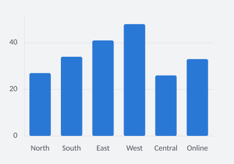
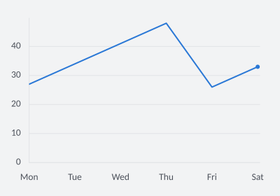
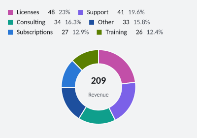
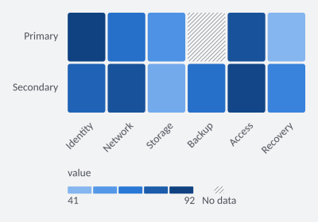
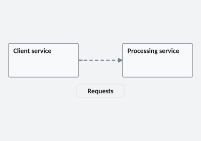
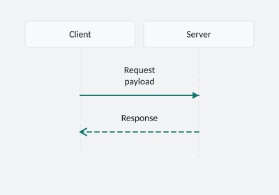

# ChartForgeX — Charts and diagrams for .NET

[](https://www.nuget.org/packages/ChartForgeX)
[](https://www.nuget.org/packages/ChartForgeX)
[](https://github.com/EvotecIT/ChartForgeX/actions/workflows/quality.yml)
[](LICENSE)

ChartForgeX turns .NET data into charts, diagrams, and report visuals. Create a chart in C#, then save it as SVG, a PNG image, or a self-contained HTML page. The core has no runtime package dependencies, and static output needs no JavaScript chart engine or browser installation.

Use it for generated reports, dashboards, documentation, email, static websites, desktop applications, and document exports. Optional packages add Mermaid input, interactive HTML, tables and metric cards, image composition, and animated visual stories.

## What you can build

| Your task | ChartForgeX provides |
| --- | --- |
| Show trends and comparisons | Lines, areas, bars, scatter and bubble plots, stacked series, mixed charts, reference lines, and annotations |
| Explain distributions and financial data | Histograms, box plots, range and error bars, candlesticks, OHLC, waterfall, and Pareto charts |
| Show proportions and progress | Pie, donut, radar, polar, gauges, bullets, funnels, pictorial charts, and progress bars |
| Explore relationships and hierarchy | Sankey, chord, tree, treemap, sunburst, and product-neutral topology diagrams |
| Show geographic or time-based data | Maps and routes, heatmaps, calendars, timelines, Gantt charts, and state lanes |
| Assemble a report or image | Chart grids; optional metric cards, tables, lists, layered canvases, backgrounds, and watermarks |
| Turn diagram source into a visual | A source-preserving Mermaid parser, typed diagram models, native rendering, and an optional Markdown-fence bridge |
| Add exploration or tell a story | Optional HTML tooltips, selection, legend controls and linked charts; optional scene playback, terminal stories, GIF and APNG |

Charts use a shared Graphite appearance with light and dark themes, measured labels, and a common frame. You can use the defaults, apply a report theme, or supply your own colors and typography.

## Install

```powershell
dotnet add package ChartForgeX
```

Supported targets are .NET Framework 4.7.2, .NET Standard 2.0, .NET 8, and .NET 10. Modern targets enable trimming and Native AOT analysis; the repository includes an executable AOT smoke check.

## Your first chart

```csharp
using ChartForgeX;
using ChartForgeX.Core;

var chart = Chart.Create()
    .WithTitle("Weekly orders")
    .WithSubtitle("Completed orders across the working week")
    .WithSize(800, 440)
    .WithXAxis("Day")
    .WithYAxis("Orders")
    .WithXLabels("Mon", "Tue", "Wed", "Thu", "Fri")
    .AddLine("Completed", ChartPoints.FromValues(28, 34, 41, 48, 32))
    .AddLine("Target", ChartPoints.FromValues(30, 35, 40, 45, 50));

chart.SaveSvg("orders.svg");
chart.SavePng("orders.png");
chart.SaveHtml("orders.html");
```

`ChartPoints.FromValues` places observations at X = 1 through N, matching `WithXLabels`. For numeric or time coordinates, use typed observations or map your own records with selectors.

## Visual Tour

Charts and diagrams share the same theme, typography and chart area. These 400 × 280 previews are generated from the current examples. Open an example to switch between light and dark, compare SVG with native PNG, or copy its C# source.

<table>
  <tr>
    <td width="50%">
      <a href="https://preview.evotec.xyz/?url=https%3A%2F%2Fgithub.com%2FEvotecIT%2FChartForgeX%2Fblob%2Fmain%2FWebsite%2Fstatic%2Fexamples%2Fgenerated%2Ffamily-bar-wide-light.html"></a>
      <br />
      <strong>Completed orders by region</strong><br />Bar
      <br />
      <a href="https://preview.evotec.xyz/?url=https%3A%2F%2Fgithub.com%2FEvotecIT%2FChartForgeX%2Fblob%2Fmain%2FWebsite%2Fstatic%2Fexamples%2Fgenerated%2Ffamily-bar-wide-light.html">Light HTML</a> / <a href="https://preview.evotec.xyz/?url=https%3A%2F%2Fgithub.com%2FEvotecIT%2FChartForgeX%2Fblob%2Fmain%2FWebsite%2Fstatic%2Fexamples%2Fgenerated%2Ffamily-bar-wide-dark.html">Dark HTML</a> /
      <a href="Website/static/examples/generated/family-bar-wide-light.svg">SVG</a> / <a href="Website/static/examples/generated/family-bar-wide-light.png">PNG</a> / <a href="Website/static/examples/generated/family-bar-wide-light.csharp.txt">C#</a>
    </td>
    <td width="50%">
      <a href="https://preview.evotec.xyz/?url=https%3A%2F%2Fgithub.com%2FEvotecIT%2FChartForgeX%2Fblob%2Fmain%2FWebsite%2Fstatic%2Fexamples%2Fgenerated%2Ffamily-line-wide-light.html"></a>
      <br />
      <strong>Weekly request volume</strong><br />Line
      <br />
      <a href="https://preview.evotec.xyz/?url=https%3A%2F%2Fgithub.com%2FEvotecIT%2FChartForgeX%2Fblob%2Fmain%2FWebsite%2Fstatic%2Fexamples%2Fgenerated%2Ffamily-line-wide-light.html">Light HTML</a> / <a href="https://preview.evotec.xyz/?url=https%3A%2F%2Fgithub.com%2FEvotecIT%2FChartForgeX%2Fblob%2Fmain%2FWebsite%2Fstatic%2Fexamples%2Fgenerated%2Ffamily-line-wide-dark.html">Dark HTML</a> /
      <a href="Website/static/examples/generated/family-line-wide-light.svg">SVG</a> / <a href="Website/static/examples/generated/family-line-wide-light.png">PNG</a> / <a href="Website/static/examples/generated/family-line-wide-light.csharp.txt">C#</a>
    </td>
  </tr>
  <tr>
    <td width="50%">
      <a href="https://preview.evotec.xyz/?url=https%3A%2F%2Fgithub.com%2FEvotecIT%2FChartForgeX%2Fblob%2Fmain%2FWebsite%2Fstatic%2Fexamples%2Fgenerated%2Ffamily-donut-wide-light.html"></a>
      <br />
      <strong>Services contributing to revenue</strong><br />Donut
      <br />
      <a href="https://preview.evotec.xyz/?url=https%3A%2F%2Fgithub.com%2FEvotecIT%2FChartForgeX%2Fblob%2Fmain%2FWebsite%2Fstatic%2Fexamples%2Fgenerated%2Ffamily-donut-wide-light.html">Light HTML</a> / <a href="https://preview.evotec.xyz/?url=https%3A%2F%2Fgithub.com%2FEvotecIT%2FChartForgeX%2Fblob%2Fmain%2FWebsite%2Fstatic%2Fexamples%2Fgenerated%2Ffamily-donut-wide-dark.html">Dark HTML</a> /
      <a href="Website/static/examples/generated/family-donut-wide-light.svg">SVG</a> / <a href="Website/static/examples/generated/family-donut-wide-light.png">PNG</a> / <a href="Website/static/examples/generated/family-donut-wide-light.csharp.txt">C#</a>
    </td>
    <td width="50%">
      <a href="https://preview.evotec.xyz/?url=https%3A%2F%2Fgithub.com%2FEvotecIT%2FChartForgeX%2Fblob%2Fmain%2FWebsite%2Fstatic%2Fexamples%2Fgenerated%2Ffamily-heatmap-wide-light.html"></a>
      <br />
      <strong>Coverage across service areas</strong><br />Heatmap
      <br />
      <a href="https://preview.evotec.xyz/?url=https%3A%2F%2Fgithub.com%2FEvotecIT%2FChartForgeX%2Fblob%2Fmain%2FWebsite%2Fstatic%2Fexamples%2Fgenerated%2Ffamily-heatmap-wide-light.html">Light HTML</a> / <a href="https://preview.evotec.xyz/?url=https%3A%2F%2Fgithub.com%2FEvotecIT%2FChartForgeX%2Fblob%2Fmain%2FWebsite%2Fstatic%2Fexamples%2Fgenerated%2Ffamily-heatmap-wide-dark.html">Dark HTML</a> /
      <a href="Website/static/examples/generated/family-heatmap-wide-light.svg">SVG</a> / <a href="Website/static/examples/generated/family-heatmap-wide-light.png">PNG</a> / <a href="Website/static/examples/generated/family-heatmap-wide-light.csharp.txt">C#</a>
    </td>
  </tr>
  <tr>
    <td width="50%">
      <a href="https://preview.evotec.xyz/?url=https%3A%2F%2Fgithub.com%2FEvotecIT%2FChartForgeX%2Fblob%2Fmain%2FWebsite%2Fstatic%2Fexamples%2Fgenerated%2Ftopology-expanded-light.html"></a>
      <br />
      <strong>Service request topology</strong><br />Topology
      <br />
      <a href="https://preview.evotec.xyz/?url=https%3A%2F%2Fgithub.com%2FEvotecIT%2FChartForgeX%2Fblob%2Fmain%2FWebsite%2Fstatic%2Fexamples%2Fgenerated%2Ftopology-expanded-light.html">Light HTML</a> / <a href="https://preview.evotec.xyz/?url=https%3A%2F%2Fgithub.com%2FEvotecIT%2FChartForgeX%2Fblob%2Fmain%2FWebsite%2Fstatic%2Fexamples%2Fgenerated%2Ftopology-expanded-dark.html">Dark HTML</a> /
      <a href="Website/static/examples/generated/topology-expanded-light.svg">SVG</a> / <a href="Website/static/examples/generated/topology-expanded-light.png">PNG</a> / <a href="Website/static/examples/generated/topology-expanded-light.csharp.txt">C#</a>
    </td>
    <td width="50%">
      <a href="https://preview.evotec.xyz/?url=https%3A%2F%2Fgithub.com%2FEvotecIT%2FChartForgeX%2Fblob%2Fmain%2FWebsite%2Fstatic%2Fexamples%2Fgenerated%2Fsequence-expanded-light.html"></a>
      <br />
      <strong>Request processing sequence</strong><br />Sequence
      <br />
      <a href="https://preview.evotec.xyz/?url=https%3A%2F%2Fgithub.com%2FEvotecIT%2FChartForgeX%2Fblob%2Fmain%2FWebsite%2Fstatic%2Fexamples%2Fgenerated%2Fsequence-expanded-light.html">Light HTML</a> / <a href="https://preview.evotec.xyz/?url=https%3A%2F%2Fgithub.com%2FEvotecIT%2FChartForgeX%2Fblob%2Fmain%2FWebsite%2Fstatic%2Fexamples%2Fgenerated%2Fsequence-expanded-dark.html">Dark HTML</a> /
      <a href="Website/static/examples/generated/sequence-expanded-light.svg">SVG</a> / <a href="Website/static/examples/generated/sequence-expanded-light.png">PNG</a> / <a href="Website/static/examples/generated/sequence-expanded-light.csharp.txt">C#</a>
    </td>
  </tr>
</table>

Explore all chart families in the [gallery](https://preview.evotec.xyz/?url=https%3A%2F%2Fgithub.com%2FEvotecIT%2FChartForgeX%2Fblob%2Fmain%2FWebsite%2Fstatic%2Fexamples%2Fgenerated%2Fcatalog.html). Each example includes light and dark themes, SVG and PNG previews, and a standalone C# recipe. Add the `ChartForgeX` package to a console project, paste the recipe into `Program.cs`, and run it to write SVG, PNG and HTML. Configured variants have their own focused recipes; an optional gallery-font download reproduces the gallery’s typography.

## Examples

The [generated gallery](https://preview.evotec.xyz/?url=https%3A%2F%2Fgithub.com%2FEvotecIT%2FChartForgeX%2Fblob%2Fmain%2FWebsite%2Fstatic%2Fexamples%2Fgenerated%2Fcatalog.html) includes chart families, diagrams, compact layouts, and light/dark variants. Each example links its HTML, SVG, native PNG, and C# source when available.

For a local copy, generate the examples from the repository:

```powershell
dotnet run --project ChartForgeX.Examples -c Release -- --output ./artifacts/gallery
```

Open `catalog.html` for the family catalog and `index.html` for the wider examples. The gallery also includes visual comparison and quality pages for contributors.

## Work with your own data

Map application records directly into a chart. `ChartDataset<T>` adds filtering, grouping, ordering, aggregation, and faceting when you need reusable data preparation.

```csharp
using ChartForgeX;
using ChartForgeX.Core;

var readings = new[] {
    new { Minute = 0d, Cpu = 35d },
    new { Minute = 5d, Cpu = 42d },
    new { Minute = 10d, Cpu = 61d }
};

var chart = Chart.Create()
    .WithTitle("CPU usage")
    .WithXAxis("Minutes")
    .WithYAxis("CPU (%)")
    .ConfigureYAxis(axis => axis.WithBounds(0, 100))
    .AddLine("CPU", readings, row => row.Minute, row => row.Cpu);

chart.SavePng("cpu.png");
```

The [API guide](docs/v2/api-conventions.md) covers category and time axes, missing observations, series options, color scales, statistical helpers, and small multiples. Stable hierarchy, flow, and interaction IDs keep selection tied to the data when labels or presentation change.

## Configure and update a series

Keep a series handle when you need to configure it or change its observations. Its ID stays the same when its display name or chart position changes.

```csharp
using ChartForgeX;
using ChartForgeX.Core;
using ChartForgeX.Themes;

var orders = ChartSeries.CreateLine(new ChartSeriesId("completed-orders"), "Completed",
    ChartPoints.FromValues(28, 34, 41, 48, 32));
orders.ConfigureMarkers(markers => markers.Radius = 4);

var chart = Chart.Create()
    .WithTitle("Weekly orders")
    .WithTheme(VisualTheme.Graphite(), VisualThemeMode.Dark)
    .AddSeries(orders);

orders.WithName("Completed orders");
chart.SavePng("orders-dark.png");
```

Charts, diagrams, grids, canvases, and stories use the same paired `VisualTheme` with an explicit light/dark mode. Customize it with `VisualTheme.Graphite().Configure(builder => ...)`; the returned theme is an independent snapshot.

Specialized series retain typed observations such as `Bubbles` and `FinancialValues`. Use their `Update*` methods to change one complete observation while keeping its ID and styling, or `Replace*` to install a new sequence. Option callbacks apply their changes after success and leave the model unchanged if they throw. See [API ownership and updates](docs/v2/api-conventions.md#stable-series-handles-and-observations) for the complete contracts.

## One layout, several outputs

Use the `Save*` helpers for everyday exports. When you need several outputs with the same layout, prepare the visual once:

```csharp
using ChartForgeX.Core;
using ChartForgeX.Rendering;
using ChartForgeX.Themes;

var chart = Chart.Create()
    .WithXLabels("North", "South", "East", "West")
    .AddBar("Orders", ChartPoints.FromValues(28, 34, 41, 48));

var context = new VisualRenderContext(
    new VisualLayoutOptions(new VisualSize(800, 440)),
    themeMode: VisualThemeMode.Dark,
    frame: new VisualFrame("Orders by region"));

var prepared = chart.Prepare(context);
string svg = prepared.ToSvg();
byte[] png = prepared.ToPng();
```

The prepared scene captures geometry, text, colors, and semantic regions. SVG and native PNG consume that scene, and the original model stays available for later edits. A shared scene keeps layout decisions together; fonts and rasterization still affect the final appearance. Register the same font files through `FontRegistry` when you need repeatable typography across hosts.

| Output | Return content | Save a file |
| --- | --- | --- |
| SVG | `chart.ToSvg()` | `chart.SaveSvg("chart.svg")` |
| Static HTML | `chart.ToHtmlFragment()` or `chart.ToHtmlPage()` | `chart.SaveHtml("chart.html")` |
| PNG | `chart.ToPng()` | `chart.SavePng("chart.png")` |
| Other still images | `chart.ToRasterImage(...)` | `chart.Save("chart.jpg")`, `.bmp`, `.ppm`, or `.tiff` |
| Reusable semantic handoff | `chart.ToVisualArtifact()` | Export or pass the artifact to a host adapter |

`To*` returns content, `Save*` writes files, and `Write*` streams output where supported. See the [artifact guide](docs/visual-artifacts.md) for Office/document integration and the [rendering architecture](docs/v2/architecture.md) for scene and export contracts.

## Reports, dashboards, and composed images

Use `ChartGrid` to arrange charts without turning page layout into chart data:

```csharp
using ChartForgeX;
using ChartForgeX.Core;

var trend = Chart.Create().WithTitle("Orders over time")
    .AddLine("Orders", ChartPoints.FromValues(28, 34, 41, 48, 32));
var regions = Chart.Create().WithTitle("Orders by region")
    .WithXLabels("North", "South", "East")
    .AddBar("Orders", ChartPoints.FromValues(52, 38, 46));

var report = ChartGrid.Create()
    .WithTitle("Order summary")
    .WithColumns(2)
    .WithPanelSize(520, 320)
    .Add(trend)
    .Add(regions);

report.SaveHtml("summary.html");
report.SavePng("summary.png");
```

Add `ChartForgeX.Visuals` for factual tables, lists, metric cards, mixed visual grids, and fixed-size canvases such as wallpapers or social images. Add `ChartForgeX.Stories` for ordered scenes, code and terminal presentations, transcripts, and GIF/APNG output. These packages use core visuals and remain independent of each other.

See [visual blocks](docs/visual-blocks.md), [visual canvases](docs/visual-canvas.md), and [stories](docs/stories.md) for their APIs and examples.

## Diagrams and Mermaid

Build product-neutral relationship diagrams with `TopologyChart`, or use the typed flow and sequence artifact models for process and interaction diagrams. Topology supports groups, ports, routed edges, status, icons, and several layout modes. Applications supply their own data and keep collection, filters, inspectors, and dashboard layout in their host.

For Mermaid input, install the optional language package:

```powershell
dotnet add package ChartForgeX.Mermaid
```

```csharp
using System;
using System.IO;
using ChartForgeX.Mermaid;
using ChartForgeX.VisualArtifacts;

var result = MermaidRenderer.Render(@"flowchart LR
    request[Request] --> review{Approved?}
    review -->|Yes| complete[Complete]
    review -->|No| revise[Revise]");

foreach (var diagnostic in result.Diagnostics)
    Console.WriteLine(diagnostic.Code + ": " + diagnostic.Message);

if (result.Artifact != null) {
    File.WriteAllText("process.svg", result.Artifact.ToSvg());
    File.WriteAllBytes("process.png", result.Artifact.ToPng());
}
```

Mermaid source is parsed into inspectable typed documents before conversion. Thirty families have native render paths, including flowchart, sequence, class, state, ER, architecture, mindmap, Gantt, and chart-oriented diagrams. Syntax and notation coverage varies by family; retained source or successful rendering does not mean every statement has a visible effect. Check diagnostics and the [support matrix](docs/mermaid-support-matrix.md) when translation fidelity matters.

ChartForgeX uses its own deterministic layout and appearance. The [Mermaid guide](docs/mermaid.md) explains source preservation, configuration, supported syntax, and the optional Markdown-fence bridge.

## Optional interactive HTML

Static HTML works without scripts. Install `ChartForgeX.Interactivity.Html` when the page needs chart exploration:

```powershell
dotnet add package ChartForgeX.Interactivity.Html
```

```csharp
using ChartForgeX.Core;
using ChartForgeX.Interactivity;
using ChartForgeX.Interactivity.Html;

var chart = Chart.Create()
    .WithTitle("Weekly orders")
    .WithXLabels("Mon", "Tue", "Wed", "Thu", "Fri")
    .AddLine("Orders", ChartPoints.FromValues(28, 34, 41, 48, 32));

chart.SaveInteractiveHtml("explore.html", options => {
    options.Interaction.Enable(
        ChartInteractionFeatures.Tooltips |
        ChartInteractionFeatures.Selection |
        ChartInteractionFeatures.KeyboardNavigation |
        ChartInteractionFeatures.Export);
});
```

The adapter also offers legend controls, crosshairs, brushing, synchronized charts, and zoom/pan. Current standalone zoom transforms the rendered SVG; native numeric X viewports are a separate core contract with narrower family support. See [interactivity](docs/interactivity.md) for feature policies and [graph explorer](docs/graph-explorer.md) for large topology navigation.

## Choose the packages you need

| Package | Purpose |
| --- | --- |
| `ChartForgeX` | Typed charts and diagrams, shared prepared scenes, typography, SVG/HTML, and native still-image output |
| `ChartForgeX.Visuals` | Tables, lists, metric cards, canvases, image composition, and watermarks |
| `ChartForgeX.Stories` | Visual and terminal stories, playback, motion, transcripts, GIF and APNG |
| `ChartForgeX.Mermaid` | Mermaid parsing, source spans, diagnostics, semantic documents, and native conversion |
| `ChartForgeX.Markup` | Markdown-friendly ChartForgeX visual fences |
| `ChartForgeX.Markup.Mermaid` | Optional Mermaid-fence bridge for the markup package |
| `ChartForgeX.Interactivity` | Host-neutral interaction contracts |
| `ChartForgeX.Interactivity.Html` | Self-contained browser adapters for charts, stories, and topology exploration |

Keep the ChartForgeX packages on the same coordinated version. Existing users can follow the [v2 migration guide](docs/v2/migration.md). Releases and downloadable artifacts are listed in [GitHub Releases](https://github.com/EvotecIT/ChartForgeX/releases).

## Development and quality checks

For code changes, run:

```powershell
dotnet test ./ChartForgeX.sln -c Release
```

For the repository quality loop, run:

```powershell
./Build.ps1 -Configuration Release
```

The quality loop builds and tests the solution, checks the pinned Mermaid reference corpus, runs the AOT smoke, generates examples, checks visual-health baselines, and packs and inspects packages. `-QualifyPackages` additionally builds and runs isolated consumers of the packed packages.

For rendered browser and interaction checks, run the same required lane used by CI:

```powershell
./Build/Test-BrowserQuality.ps1 -OutputRoot (Join-Path ([IO.Path]::GetTempPath()) 'chartforgex-browser-quality')
```

It generates and serves a fresh gallery, opens Chromium through HtmlTinkerX, and retains test results, screenshots, and console evidence in the chosen output directory. Required browser checks fail if setup is missing or tests are skipped; the ordinary test loop reports optional browser checks as skipped when they are disabled. Numerical visual-health baselines and browser contracts cover different failure modes, so inspect the charts as well.

Inspect the generated gallery before intentionally changing visual baselines. [Contributing](CONTRIBUTING.md) describes the development workflow; [TODO.md](TODO.md) records active priorities and completion criteria.

## Reference and support

- [API conventions and chart options](docs/v2/api-conventions.md)
- [Chart combinations, orientation and axes](docs/v2/chart-combinations.md)
- [Topology](docs/topology.md) and [icon packs](docs/topology-icon-packs.md)
- [Typography and measured label placement](docs/label-placement.md)
- [Mermaid language support](docs/mermaid.md) and [support matrix](docs/mermaid-support-matrix.md)
- [Visual artifacts](docs/visual-artifacts.md), [visual blocks](docs/visual-blocks.md), [canvases](docs/visual-canvas.md), and [stories](docs/stories.md)
- [Interaction adapters](docs/interactivity.md) and [graph explorer](docs/graph-explorer.md)
- [Architecture](docs/v2/architecture.md), [migration](docs/v2/migration.md), and [active roadmap](TODO.md)

ChartForgeX is maintained by [EvotecIT](https://github.com/EvotecIT). Ask questions in [Discord](https://evo.yt/discord) or report reproducible problems in [GitHub Issues](https://github.com/EvotecIT/ChartForgeX/issues). If the library helps your work, you can support its development through [GitHub Sponsors](https://github.com/sponsors/PrzemyslawKlys).
