# Mermaid

ChartForgeX.Mermaid is the Mermaid language package for ChartForgeX. Its job is to parse Mermaid source into inspectable, source-preserving models and, where implemented, convert those models into deterministic ChartForgeX visuals.

It is intentionally separate from `ChartForgeX.Markup`:

- `ChartForgeX.Mermaid` owns Mermaid parsing, diagnostics, AST models, and Mermaid-to-ChartForgeX conversion.
- `ChartForgeX.Markup` owns generic Markdown fence scanning and built-in ChartForgeX fences.
- `ChartForgeX.Markup.Mermaid` is the optional bridge that adapts Mermaid fences into generic markup results.

This split keeps ChartForgeX dependency-free at runtime, keeps Markdown support reusable, and lets hosts opt into Mermaid only when they need it.

## Support Policy

Mermaid support should grow as a real language surface, not as a small custom subset that only works for demo strings.

For each Mermaid family ChartForgeX supports, the implementation should:

- Preserve the original source and one-based source spans for diagnostics.
- Parse Mermaid syntax into typed AST models before rendering.
- Keep raw statements where semantic coverage is still growing, so future parser work does not need to rediscover source structure.
- Detect recognized Mermaid diagram families even before they can render.
- Report unsupported or not-yet-renderable syntax clearly instead of silently pretending it rendered.
- Map implemented Mermaid concepts into ChartForgeX visual models with deterministic SVG and PNG output.
- Keep runtime parsing and rendering in .NET without requiring browser JavaScript.

Reference rendering tools can be useful in tests and compatibility checks, but they are not a runtime dependency for ChartForgeX packages.

The current semantic reference is Mermaid.js 12.2.0. The test harness also qualifies its recorded examples against pinned 10.9.8 and 11.17.2 references. Older spellings such as `graph`, `stateDiagram`/`stateDiagram-v2`, and `xychart`/`xychart-beta` are accepted where implemented. These fixture results do not establish complete compatibility with every Mermaid 10, 11 or 12 release.

The [Mermaid roadmap](../TODO.md#mermaid) plans newer-syntax adoption and regression coverage for supported older syntax. The [support matrix](mermaid-support-matrix.md) separates native render paths, retained-only features, approximate mappings and missing families. CFX uses its own deterministic scene and appearance; syntax compatibility does not imply the same layout or pixels as Mermaid's browser renderer.

## Current Scope

The families in the [support matrix](mermaid-support-matrix.md) have typed semantic models and native rendering for their documented subsets. Graph-shaped families use `TopologyChart`, including C4 nested boundaries and Agentflow containers. Sequence and ZenUML documents use `SequenceArtifact`, with a separate parser for each grammar. Journey, Timeline and Railroad use `JourneyDiagramBlock`, `TimelineDiagramBlock` and `RailroadDiagramBlock`; git graph, block, packet, Venn, Ishikawa and Wardley use their corresponding native visual blocks. Pie, quadrant, Gantt, XY chart, Sankey, radar and treemap use native `Chart` models.

`zenuml`, `agentflow-beta` and the four Railroad headers produce typed documents through the shared renderer and Markdown fence bridge. Their expressions, connector descriptions and workflow instructions remain inert diagram data. None of these paths executes a JavaScript plugin, an authored expression or a referenced grammar rule. Unsupported constructs still have explicit diagnostics; a native path does not promise complete upstream grammar or reference layout.

Library-produced diagnostics expose stable `Code` values: `CFXM001` for an unknown family, `CFXM002` for a recognized family without native rendering, `CFXM003` for an authored layout that uses the native static fallback, `CFXM004` for native conversion failure, `CFXM005` for configuration retained without native application, `CFXM006` for invalid or over-limit configuration, `CFXM007` for a retained statement or styling without native application, `CFXM008` for malformed or invalid notation, `CFXM009` for a deliberately approximate native mapping, `CFXM010` for a resource limit, and `CFXM011` when host policy rejects warnings. The Markdown bridge preserves the codes and maps source lines and columns into the host document. Use codes and severity for host policy; messages explain the specific source statement or rendering limit.

Journey and timeline documents render through native diagrams with visible sections, actors, scores, categorical periods and ordered events. Venn circles preserve set-area ratios; two-set overlaps are exact within numeric precision, while a three-circle fit exposes requested and actual region areas. A Venn fit beyond half a percent of the largest set reports `CFXM009`. C4 preserves native nested boundaries and supported paint updates, while its specialized layout still reports `CFXM009`. These diagnostics describe source semantics rather than theme differences. Inspect warnings before accepting output for a workflow that requires exact notation. Errors prevent the shared renderer and Markdown bridge from producing an artifact.

Unknown diagram families produce a parser error.

For the family-by-family completion status, evidence, and priority order, see the [support matrix](mermaid-support-matrix.md).

## Render source directly

Use the shared renderer when the diagram family is selected by the source:

```csharp
using ChartForgeX.Mermaid;
using ChartForgeX.VisualArtifacts;

MermaidRenderResult result = MermaidRenderer.Render(source);
if (!result.HasErrors && result.Artifact != null) {
    result.Artifact.SaveSvg("diagram.svg");
    result.Artifact.SavePng("diagram.png");
}
```

Inspect `Diagnostics` even when rendering succeeds: warnings identify syntax or configuration retained without exact visual interpretation. `accTitle` and single-line or multiline `accDescr` provide accessible names and descriptions. The `dark` and `default` source themes select static palettes. Source font stacks reach chart, topology, sequence and visual-block owners; native font resolution uses the existing fallback rules and does not fetch remote fonts. Additional themes and settings follow the documented family mappings; unsupported settings produce approximation warnings.

The artifact title comes from the family render option `Title`, then the diagram's own `title` statement, then the frontmatter `title`, then a family name such as `Mermaid flowchart`. Like Mermaid, rendered diagrams have no subtitle by default; set the family option `Subtitle` (for example `options.Flowchart.Subtitle`) to add one. The header keyword line stays available as `mermaid.header` artifact metadata.

`MermaidRenderOptions` lives in `ChartForgeX.Mermaid` and supplies family defaults to both the source renderer and `MermaidVisualMarkupParser`. Replace the former `ChartForgeX.Markup.Mermaid.MermaidVisualMarkupRenderOptions` type with this shared type when migrating source code.

Topology diagram dimensions set the minimum canvas. The renderer expands the canvas when node content or relationship notation needs more space; the artifact's natural size reports those rendered dimensions.

## Shared host presentation and resource policy

`MermaidRenderOptions.Presentation` supplies host defaults for every family. Each family option inherits `MermaidDiagramRenderOptions` and can override individual presentation fields. Native defaults apply first, then source configuration, shared host presentation, and explicit family presentation. Null fields inherit; rendering does not rewrite the source document.

```csharp
var options = new MermaidRenderOptions {
    Presentation = new MermaidPresentationOptions {
        FontFamily = "Carlito",
        FontSize = 16,
        ThemeMode = VisualThemeMode.Dark,
        TopologySizing = MermaidTopologySizing.Natural
    },
    Sequence = new MermaidSequenceRenderOptions {
        Presentation = new MermaidPresentationOptions { FontSize = 18 }
    },
    WarningPolicy = MermaidWarningPolicy.Reject,
    ParseOptions = new MermaidParseOptions {
        ResourceLimits = new MermaidResourceLimits {
            MaximumSourceCharacters = 524288,
            MaximumElements = 5000,
            MaximumEdges = 20000,
            MaximumNestingDepth = 64,
            MaximumOutputBytes = 8388608,
            MaximumRasterPixels = 16777216
        }
    }
};
var rendered = MermaidRenderer.Render(source, options, cancellationToken);
```

`Natural` is the default and keeps measured topology text sizes and expands the output canvas. Its standalone HTML uses a keyboard-accessible scroll region. `FixedViewport` scales completed topology geometry into the family width and height; it can make dense labels small. Other native families retain their own layout contracts. An explicit `VisualArtifactRenderOptions.HtmlSizing` overrides the producer's HTML sizing without changing SVG or PNG geometry. Font requests use native resolution and do not download fonts.

`Allow` returns warnings with the supported output. `Reject` prevents artifact creation when parsing reports any warning, including retained statements and approximate native mappings. It is a source-loss policy, not a guarantee of reference pixels. `MermaidRenderer.RenderParsed` converts an existing generic parse result without parsing again; the Markdown bridge uses the same result and policy boundary.

Limits are copied for each request. Raw UTF-16 source, line lengths, expanded edges, model counts and nesting are bounded; SVG UTF-8 bytes and completed PNG/HTML bytes are checked at export, and the exact native destination dimensions, including output scale, are checked before raster allocation. Invalid source and parse-budget failures return located diagnostics. Deferred export can throw `MermaidResourceLimitException`, so hosts should handle that alongside export I/O errors. The default output pixel limit counts destination pixels; native raster working-buffer guards remain in force. Low-level native models returned by `ToChart`, `ToTopologyChart` or `ToSequenceArtifact` retain their native mutable contracts; use Mermaid artifact/export methods to retain the source request's output policy.

Cancellation throws `OperationCanceledException`, rather than misreporting malformed Mermaid. Parsing checks it cooperatively and artifact exports check it before and after native work. It cannot interrupt a native layout operation already executing and is not a hard wall-clock deadline. A captured artifact retains its request token for later exports. No source callback, remote asset fetch or browser renderer is introduced.

## Source configuration

`MermaidDocument.Configuration` exposes the effective `Theme`, `Layout`, `Look`, `FontFamily` and `FontSize`, plus retained `Settings` with dotted paths, scalar values and original locations. `Theme` on the document addresses the same effective theme for callers that convert a model directly.

Configuration merges in this order: frontmatter first, then legacy directives in source order. Later values at the same path win. A recognized theme or look scoped to the current diagram family wins over the corresponding global value, even when a later directive changes only the global setting. Only diagram scopes defined by the supported Mermaid configuration schema participate in this precedence; treemap uses the global appearance settings. Recognized themes include `neo`, `neo-dark`, `redux`, `redux-dark`, `redux-color` and `redux-dark-color`; their names are retained with the native-presentation approximation warning. An unrecognized scoped theme or look retains a warning and allows the global value to apply. The latest global and active-family theme, layout and look values must each be non-empty strings, even when one overrides the other. Settings for inactive families remain retained with diagnostics. Layout names retain scoped precedence because the upstream layout registry is extensible. Host-specific presentation remains available through the converted native model and shared export context; the source settings do not select a browser layout engine.

`themeVariables.fontFamily` selects the native default font stack for chart, topology, sequence and visual-block output. It overrides root `fontFamily`, including when a later directive changes only the root setting. Unsupported family keys such as `flowchart.fontFamily` retain a diagnostic and do not change that selection. The original declarations remain in `Settings`, and `Configuration.FontFamily` reports the effective native stack. This sets the shared native typography default; it does not reproduce every Mermaid family-specific font role or fetch remote fonts.

Shared source color variables configure the existing immutable paired theme. Explicit host `Presentation.Theme` takes precedence over these defaults; explicit node, edge and family paint still uses its native owner. The mapping is the same for direct and fenced SVG/PNG output:

| `themeVariables` key | Native presentation role |
| --- | --- |
| `background` | Canvas background; explicitly draws the canvas on native chart families that otherwise remain transparent |
| `primaryColor` | Primary and weakest neutral surfaces |
| `secondaryColor` | Elevated surface and secondary accent |
| `tertiaryColor` | Middle neutral surface |
| `textColor` | Primary and secondary text |
| `primaryTextColor` | Primary text, overriding `textColor` for that role |
| `primaryBorderColor` | Default borders |
| `lineColor` | Axis/grid rules and default topology relationships |

Colors use the existing native color parser. Invalid supported color values produce located errors, and unknown color keys retain diagnostics. These roles configure CFX presentation rather than reproducing a named upstream browser theme; native geometry and family-specific paint remain deliberate. Source colors apply to both paired modes, so switching the host mode preserves authored colors. An explicit native preparation context can supply a different complete theme.

`themeVariables.fontSize` sets the native base data-label size in logical pixels, with other native text roles scaled proportionally. Native block body roles use `VisualTheme.Typography.DataLabelSize`; headings use their own scaled roles. In a fixed chart or block viewport, oversized headings fit within a bounded share of the content height. Block cells, Venn captions, Wardley labels and fishbone effect/cause labels fit measured width and height limits. Wardley plot margins reserve scaled annotation circles, including their strokes at domain boundaries, while connector captions retain a separate placement role. Fitting measures the actual font size, including fallback fonts, discrete bitmap advances on fontless hosts and synthetic emphasis. Native caption placement and shortening use those same raster metrics. Oversized Cartesian tick labels fit their complete rotated footprints within measured strips and tick spacing, and axis titles share the reserved strip with ticks. The authored font size remains in the model. Oversized chart legends fit their frame budget and retain the normal overflow summary for dense entries. Long headings shorten using measured font widths. Packet field captions and bit numbers fit the remaining row space and their individual field widths. Git branch, commit and tag captions fit their measured lane and badge bounds. Block headings normalize line breaks and XML whitespace before measurement; source and model strings remain intact. Journey and Timeline body captions retain explicit multiline content through their measured native text owner. Topology group headers, actor and tile captions, and subtitle chips fit their reserved cells. Compact actor figures shrink within their node bounds, with routing and caption placement following the same geometry. Git endpoint reserves include scaled cherry-pick markers and marker strokes.

The setting accepts a number or CSS pixel string such as `18.5px`, `18PX`, `1e2px` or `+1.8e1px`, from 1 through 256. Pixel units are case-insensitive. `Configuration.FontSize` reports the applied size. Relative units, physical units, CSS size keywords such as `math`, and CSS expressions remain in the source with an unsupported-configuration warning. Sizing functions require one balanced enclosing call, including nested parentheses, quoted text and comments; their expressions are not evaluated. Escaped line breaks are accepted only inside quoted CSS strings; unquoted escapes before CR, LF or form feed report an invalid configuration. Malformed delimiters and invalid pixel sizes produce one located configuration error. Global and family-specific `fontSize` settings retain their diagnostics.

SVG and PNG share the resulting typography; topology and sequence `Prepare` calls with an explicit host context use that context instead of the authored defaults. Native fitting can shorten labels within fixed bounds; oversized topology node labels use the existing measured fitting path. Standalone sequence exports widen lanes to fit individual text elements and grow the canvas to keep headings, participants, messages and notes separate. Explicit host viewports retain their measured-fit limits.

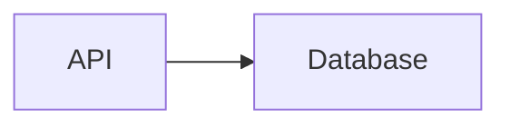

The supported YAML subset uses consistently space-indented mappings with plain, single-quoted or JSON double-quoted scalar values and comments. Mapping keys can also use single or JSON double quotes. Quoted values in a root flow mapping fold physical line breaks according to YAML scalar rules. Nested mapping paths are retained. JSON objects are also accepted as the value of the root `config` key. YAML anchors, aliases, tags, sequences and block scalars are not interpreted as native settings. Their source remains available, and unsupported root and nested declarations produce diagnostics. Later supported initialization directives still apply. An opaque value at an effective required string setting is invalid, just like a non-string JSON value; a later supported value at the same path can replace it.

Plain YAML scalars follow the YAML 1.2 printable Unicode ranges, including complete supplementary characters. Space and tab separate YAML values and comments; other printable Unicode characters remain part of the scalar. Quotes inside a plain scalar are literal text. Quoted scalars preserve non-C0 characters for JSON compatibility. Literal C0 control characters other than tabs produce `CFXM006`. JSON configuration accepts only space, tab, line feed and carriage return outside strings.

Plain Boolean/null spellings, finite decimal and radix numbers, and YAML `.inf`/`.nan` forms retain their scalar types. Theme, layout, look and font-family settings require strings, so other scalar types report `CFXM006`; the pixel font-size setting also accepts decimal numbers. Quoting preserves a string. Mixed-case spellings such as `tRuE`, bare `Infinity`, and overflowing decimal forms such as `1e9999` remain strings, following the current reference's YAML reader. This classification is consistent across the supported .NET targets.

Legacy `%%{init: {...}}%%` and `%%{initialize: {...}}%%` declarations accept quoted JSON keys and either single-quoted or double-quoted strings. The opener `%%{` is contiguous; a line beginning with `%% {` is an ordinary comment. Declarations can span lines and appear before or after the family header. Blanking declarations before family parsing preserves the original locations of nodes and other statements. YAML settings identify their declaration; root flow mappings retain each property's original span across lines, comments and quote normalization. Legacy settings identify the complete directive declaration. Finite JSON numbers retain their authored spelling, including small exponents and long fractions.

JSON configuration numbers must use JSON number syntax and fit the native reader's finite double range; overflow and leading zeroes report `CFXM006` on every target. YAML single-quoted strings, including those in root flow mappings, escape an interior quote by doubling it (`'Arial''s, serif'`) and preserve literal backslashes. Legacy `init` single-quoted strings retain JSON-style backslash escapes. Unescaped interior quotes are invalid configuration.

Configuration is limited to 65,536 characters across the YAML `config` declarations and legacy declarations, 256 retained settings, eight JSON/mapping levels and 4,096 characters for each latest global or active-family theme/layout/look value and effective font string. Effective presentation strings contain complete Unicode characters; font names also use XML-compatible characters so native artifacts can export to SVG. Unsupported sequence bodies, including indentless items, count toward the configuration budget. Unrelated frontmatter metadata, whole YAML comment lines and blank lines outside scalar content do not consume it. Physical block-scalar and quoted flow-scalar bodies count, including lines beginning with `#` and whitespace-only lines. Comments do not end the active mapping; following indented settings remain subject to its limits. Over-budget declarations are omitted from the bounded directive collection; the original source remains available. YAML has an additional 256-key limit. Duplicate keys within one supported mapping, inconsistent sibling indentation, invalid supported values and over-limit input report `CFXM006` and prevent the shared renderer from producing an artifact. Repeated legacy declarations remain valid and merge in order.

Unmapped `layout`, `look`, `defaultRenderer`, theme variables and family options remain inspectable without changing the native scene. Layout requests report `CFXM003`; other unmapped settings report `CFXM005`. Supported radar paint and typography settings are documented under [Radar Diagrams](#radar-diagrams). A theme such as `forest` retains its name and reports the native-presentation approximation. This does not reproduce Mermaid's browser appearance or every YAML form.

## Process diagrams

Flowchart and Swimlane nodes resolve responsibility membership in subgraph close order, matching the source DB contract. The first closed subgraph containing a node owns that node. A nested group closes before its ancestor, so it retains ownership even if the ancestor mentioned the node earlier. Later edge references in an ancestor or sibling retain that ownership while still applying authored label/shape/style updates. An ungrouped reference does not clear a group.

`MermaidFlowchartNode.SubgraphId` is the semantic owner used by native `GroupId` and portable restoration. `MermaidFlowchartSubgraph.NodeIds` retains authored node references, merged across declarations of the same group ID in close order; the same node can appear in multiple raw reference lists. Source text, raw statements, spans and declaration order remain intact. Consumers that need actual membership use each node's `SubgraphId`. This intentionally replaces former last-reference reassignment without a compatibility switch. Repeated subgraph IDs merge into one canonical `Subgraphs` entry. The first actually completed declaration owns the title, direction and span; unique IDs keep source first-ID order. Later declarations merge their raw node references in close order. A nested self-redeclaration flattens and its inner completed declaration owns those presentation facts. Group IDs use the same first-closed claims as nodes, including references that precede a group declaration and later wrappers that claim a previously unparented group. Genuine parent-reference cycles report located `CFXM008` and produce no artifact. Every original header, direction, reference and span remains in `SourceText` and `Statements`; `Subgraphs` is the canonical semantic view. The complete `flowchart-repeated-subgraphs.mmd` fixture covers sibling merges, a later wrapper, self nesting and later label updates in both ordinary families. Its native/direct/fence/portable/browser and pinned12 contracts require current-candidate execution. The complete `flowchart-membership.mmd` fixture is maintained through both ordinary headers, direct/fenced exports and packed/browser/reference contracts; current-candidate execution remains required.

`swimlane-beta` uses flowchart statements. Subgraphs define actual responsibility groups, including nested lanes. Their existing native parent IDs determine containment. Cards declared directly in a parent occupy an internal band before its child lanes; a parent containing only child lanes gets no invented empty responsibility band. Node and sibling declaration order is retained.

Resource accounting distinguishes canonical identity from source allocation. Every group opening consumes an allocation once. At the first repeated ID, nodes already retained are charged once; each newly created node is charged once thereafter. Merging does not refund those allocations. Unique-ID sources retain their established final semantic counting order. A merged required `mermaid.nodes` fact is checked against the existing 65,536-character portable text ceiling before composition; an over-bound later occurrence reports a located resource diagnostic instead of truncating source facts or failing later during artifact export.

Lanes without an effective local direction share one process-rank table, including ungrouped actors and cards at different nesting depths. Ancestor caption/icon reservations and the deepest required inset establish the common process origin. `LR`/`RL` stack responsibility bands down the page; `TB`/`TD`/`BT` stack them across the page. Reversal mirrors the global process axis through the existing port/waypoint owner while actual group headers and containment remain intact. An effective local subgraph direction uses the existing recursive native group composition instead. Null directions and directions equal to the inherited direction keep the shared-rank lane path. A locally composed region trades global process-rank alignment across all responsibilities for actual local `LR`/`RL`/`TB`/`BT` geometry, while preserving real group IDs, membership, containment, ports and cross-boundary edges. A source member connected outside its subgraph inherits the parent direction, matching the existing Flowchart source rule; a link to the group shell keeps its local direction. Compact `PreserveSize` HTML hosts scroll the natural scene.

The maintained `swimlane-native-nesting.mmd` source exercises parent-owned work, three hierarchy levels, cross-lane handoffs, a longer rank span and an external actor. Native, portable, direct/fenced, browser and pinned12 reference contracts retain actual identities and captions; their declarations require current-candidate execution. Shallow native lane diagrams with null options and no effective local direction retain their existing layout path and SVG/PNG/portable default bytes.

Swimlane source settings use their actual pinned configuration paths: `flowchart.nodeSpacing` and `flowchart.rankSpacing` map to native `TopologyRenderOptions.LayeredNodeSpacing` and `LayeredRankSpacing`; `flowchart.diagramPadding` supplies padding unless the host explicitly supplies it; `flowchart.useMaxWidth` maps the existing completed-content fit policy unless host `TopologySizing` is explicit. Natural native sizes, measured captions, shell insets and routing remain CFX-owned; these settings do not reproduce every upstream distance or browser font.

Explicit `swimlane.ignoreCrossLaneEdges: true` selects native `SwimlaneIgnoreCrossLaneRankConstraints`. It excludes rank constraints only when both endpoints belong to different outermost responsibilities; it retains ungrouped constraints, within-responsibility hierarchy constraints, actual edge IDs, routes and ports. Authored rank minima remain lower bounds. Source conversion delegates the filtered inference to that same component/longest-path rank owner instead of supplying earlier all-edge adapter hints. Native null/false retain their incumbent behavior. The source default without an explicit declaration is also unchanged; the pinned renderer currently defaults this source option to true, an intentional remaining default difference.

The complete `swimlane-native-layout-depth.mmd` source and downloadable `SwimlaneLayoutDepthProgram.cs` exercise spacing, local directions and a real shell handoff in direct and fenced compact/wide light/dark outputs. Native render options remain host policy: prepared portable restoration preserves the actual manual geometry and typed membership, rather than inventing an editable host-layout options protocol.

`swimlane.automaticLaneOrdering: true` selects native `SwimlaneAutomaticLaneOrdering`: a finite deterministic weighted arrangement of outer responsibility bands. It reduces the distance objective of actual cross-responsibility edge counts, retaining source graph collections, child order, IDs and membership. It is a bounded heuristic with source-distance tie-breaking, not an optimum or pinned-order guarantee. Null/false retain source order. `swimlane-automatic-ordering.mmd` can be passed to the same complete downloadable program to inspect native/browser SVG/PNG geometry.

`swimlane.optimizeRanksByCrossings: true` selects native `LayeredOptimizeRanksByCrossings`. The same native SCC/rank preparation retains authored numeric minima, component membership, backward direction, retained minimum spans and the explicit cross-lane constraint filter. A bounded greedy pass tries finite occupied-rank/bound candidates inside feasible predecessor/successor windows and accepts only lower stable normalized rank-segment crossing scores. It can use legal later-rank slack as well as an earlier feasible rank; it is not the pinned renderer's identical lifting heuristic or a guarantee about final routed paint crossings. Private work/candidate limits retain the best actual evaluated state; null/false keep incumbent bytes. Active use outside automatic Layered/Swimlane coordinates is rejected.

`lineHops: false` retains incumbent paint. True/`arc`/`gap` line hops remain an **open capability gap** and report located unsupported configuration; strict warning policy rejects them. Diagnostics do not implement crossing paint. Source styles and additional dense routing/label/reference qualification also remain open.

`usecase-beta` uses the Mermaid 12.2 notation for actors, ellipse or rectangle use cases, system boundaries, associations, include/extend links and generalization. Include and extend require use case endpoints; generalization requires endpoints of the same kind. Associations use direct routes with bends where needed to avoid actor captions; relationship stereotypes receive space between their endpoints. Nested system boundaries are rejected.

`note for Publish "Approval required"` attaches a native annotation to the actual actor or use case. `actor Operator("Release coordinator") <<primary>>` keeps the node label and source stereotype separate and displays `«primary»` through the native node subtitle. Notes are available through `MermaidUseCaseDocument.Notes`. Exact source text and the physical stereotype, note and named-association spans remain bounded portable metadata; they do not become a second identity system.

An association can declare an identity at its link token: `Operator request@-- "requests" --> Publish`. `MermaidFlowchartEdge.Id` retains that identity in native selection and portable output. A null ID preserves the existing `mermaid-edge-N` source-order identity. UseCase `classDef`, `class` and `style` resolve existing actors, use cases or explicitly named associations after declarations. Selectors never create substitute nodes; unresolved, anonymous or colliding identities are located errors. Node fill, stroke and label color use the native node owner. Named associations support independent stroke and label color, positive `stroke-width`, opacity and exact positive `stroke-dasharray`; odd-length patterns repeat once according to CSS dash semantics. Unsupported declarations remain warnings and `MermaidWarningPolicy.Reject` stops rendering them. `linkStyle` remains flowchart notation, rather than a UseCase selector.

Source `usecase.actorFontFamily`, `actorFontSize`, `actorFontWeight`, `usecaseFontFamily`, `usecaseFontSize`, `usecaseFontWeight`, `wrappingWidth`, `minNodeWidth` and `diagramPadding` lower to native typography, wrapping, body width and viewport padding. Explicit host font family/size and family `Padding` override their corresponding source fields. Other settings retain located diagnostics. The ordinary `usecase-source-depth` recipe authors a native Core chart; the shared `.mmd`, parsed-source example and emitted source program exercise the Mermaid package separately.

Actor metadata `type:hollow`, `type:awesome` and `business:true` now selects native outlined, filled-silhouette or business-marked geometry. Business applies to normal/hollow actors and ellipse use cases; icon/awesome business combinations and rectangular business use cases are errors, matching the pinned notation. A source `icon:"network:router"` resolves an exact id through `MermaidFlowchartRenderOptions.IconCatalog` or the built-in `TopologyIconCatalog`. No external icon packs, inferred Font Awesome aliases or network provider are loaded. The catalog is copied during conversion and host snapshots; resolved native shape, kind, symbol and safe artwork become ordinary retained node facts while `IconId` keeps the authored reference. An unresolved id is a located warning, with the frame, caption and source metadata retained; strict warning rejection stops rendering it.

The generic Core forms are `ActorHollow`, `ActorBusiness`, `ActorBusinessHollow`, `ActorSilhouette`, `ActorIcon` and `BusinessEllipse`. They share native caption, footprint and attachment owners. `TopologyNode.IconShape` optionally retains a native glyph independently of its catalog id; null preserves inference and `Auto` keeps its existing fallback. These new forms and non-null glyph policy require portable version 2. JSON vertices use the linked native table-content owner below. Boundary styles, package geometry and unsupported source layout/style properties remain open; native anatomy does not promise byte-identical reference pixels or arbitrary external icon appearance.

`cynefin-beta` supports the five fixed domains, quoted domain items, titles, and labeled domain transitions. Its native topology uses four quadrant fills, seeded cubic fold and horizontal boundaries, a stronger cliff and a central confusion ellipse. The optional domain descriptions include “Disorder” under confusion; `disorder` is not a separate grammar domain. All authored items remain visible, with native dimensions acting as lower bounds rather than clipping requests. Supported `cynefin` configuration includes `width`, `height`, `padding`, `showDomainDescriptions`, `boundaryAmplitude`, `seed` and `useMaxWidth`; supported family theme values include domain fills, boundary/cliff/arrow paints and widths, label/item text colors, `domainFontSize` and `itemFontSize`. Authored domain sizes apply to labels and the common title (+2); authored item sizes apply to items, descriptions (-1) and transition labels (-1). These use native measured typography, retain native defaults when omitted, and respect an explicit host font-size override. `textColor` paints items, descriptions and transition labels independently from `labelColor`. SVG, static HTML and PNG use the same captured paths. Typed portable JSON uses version 2 for the ordered numeric path commands and subtitle roles. Retained hierarchy sources keep authored coordinates while ordinary snapshots keep fitted coordinates. Single and double quoted items and transition labels use the pinned string escapes, including literal physical newlines; unknown escapes drop the backslash without Unicode decoding. A repeated domain block replaces its items, while source text and statement spans retain every block. Valid self loops remain in source and are excluded from rendered transitions, matching the family database. Descriptions use the generic italic subtitle role. Detail badges share a native measured surface plan with factual table badges, with captured fill, independent stroke, padding and radius. Transition quadratics are retained exactly through equivalent cubic commands in the generic edge geometry owner. Transition labels pin the family's actual text baseline through the generic immutable label-position owner. Endpoint markers reuse the native painter with stroke-width-scaled geometry, the reference refX offset and a fill-only stroke. The first text row uses its actual resolved native font ascent rather than an approximate font offset. Native frame, font defaults and the all-item layout remain in force; pixel identity is qualified separately. All confusion items remain visible; the reference renderer instead caps its painted badges at three. The full reference API preprocesses comments/directives before its family grammar; native quoted continuation data remains literal under the shared metadata policy.

Modern flowchart metadata (`A@{ shape: cloud, label: "API" }`) preserves node identity and label text. Apostrophes are literal text in ordinary node and edge captions, including leading forms such as `A -- 'til complete --> B`. Double-quoted captions protect embedded operators and statement separators. Fan-out groups (`A & B --> C & D`) emit every connection. Supported legacy shapes and the cloud, actor, and ellipse surfaces share SVG/PNG geometry; unsupported metadata has explicit warnings.

Flowchart links preserve circle (`A ---o B`), cross (`A ---x B`) and bidirectional endpoints (`A o--o B`, `A x--x B`, `A <--> B`) in native SVG/PNG and interchange JSON. A leading `o` or `x` adds a source marker only when the target endpoint matches; mixed links such as `A o--x B` retain only the target cross. A compact link consumes one endpoint marker: `A---oxTarget` connects to `xTarget` with a circle, while `A--- xTarget` connects without a marker. Text inside an inline or pipe label does not introduce endpoint markers or reverse the inferred layers. The existing native backward-arrow interpretation of `A <-- B` is retained.

The metadata shape names `fr-rect` and `framed-rectangle` select the native subprocess surface; `question` selects a decision diamond; `lean-right` and `lean-left` select the two input/output parallelograms. `manual` and `trapezoid-top` select the upper-base trapezoid, while `priority` and `trapezoid-bottom` select the lower-base trapezoid. `odd` selects the asymmetric surface. These names use the same geometry as their supported short names or bracket notation. Expanded shapes without a native owner retain a warning and rectangle fallback.

Gantt duration calculations apply `excludes`, `includes`, and Friday/Saturday weekend definitions. Explicit end dates stay explicit. Milestones use the midpoint of their authored duration, and `active` does not invent a percentage complete.

## Flowcharts

Flowchart nodes use the prepared context's resolved font to size enclosed captions before layout and routing. Font substitution and the bitmap fallback therefore use the same metrics for the box and its SVG/PNG text. `MermaidFlowchartRenderOptions.FitContent` enables this policy by default; disable it to retain fixed node sizes and their bounded text fitting. Actor captions keep their external placement. Native topology callers can opt a plain enclosed node into the same minimum-size policy with `TopologyNode.FitLabelToContent = true`.

Supported flowchart parsing includes:

- `flowchart`, `graph` and `flowchart-elk` headers. `flowchart-elk` retains flowchart semantics and emits `CFXM003` because the native static renderer uses ChartForgeX layout.
- Directions such as `TD`, `TB`, `BT`, `LR`, and `RL`.
- YAML-style frontmatter and Mermaid directive comments.
- Common node references and labels.
- Common node shapes, including rectangle, rounded, stadium, subroutine, cylinder, circle, double circle, rhombus, hexagon, and parallelogram variants.
- Edge operators, pipe labels, inline labels, dotted operators, and chained edges.
- Longer normal, thick and dotted operators request larger minimum rank spans; caption punctuation does not affect spacing.
- Quoted pipe captions retain embedded pipes. Inline captions retain comparison signs, brackets, and semicolons. Node metadata decodes YAML single-quoted scalars, including doubled apostrophes and literal backslashes, while apostrophes in ordinary captions remain text.
- `subgraph ... end` groups.
- `classDef`, `class`, and inline `:::class` node classes.
- `style` node declarations.
- `click` href and tooltip metadata.
- `linkStyle` declarations, including numeric selectors and `default`.

Flowcharts accept semicolon-separated statements, including statements on the header line. Semicolons inside quoted labels, node shapes, and pipe edge labels stay inside that label. Every retained statement carries its original line and column. Incomplete shapes, missing edge targets, and unmatched `subgraph`/`end` declarations produce located errors; unsupported trailing syntax is diagnosed instead of being silently discarded.

Flowchart node styles apply `classDef default` and `classDef node` first, then assigned classes in assignment order. `classDef color,box fill:#fed7aa` defines both classes. Repeated definitions merge their properties, with later values winning; repeated assignments retain their place in the source order. Direct `style` declarations override class properties regardless of where the class is defined. Inline names such as `color`, `box` and `external-box` remain intact before compact links (`A:::color-->B`). Each node declaration accepts one inline suffix; use `class A color,box` to assign several classes. A comma inside `A:::color,box` belongs to one literal class name.

Native node paint maps `fill`, `stroke` and text `color`; links map `stroke` and line style. Nonzero numeric `stroke-dasharray` patterns select the shared native dashed pattern and report `CFXM007` because authored dash lengths are retained without exact application. `none` and all-zero patterns select a solid line. The last `linkStyle default` declaration supplies the base, and the last declaration for an edge index overrides it, even when the default appears later. Unsupported properties or paint values remain inspectable with `CFXM007`. Numeric link selectors must refer to edges already declared at that statement; `default` can appear before edges. Invalid edge selectors and empty or repeated inline suffixes report `CFXM008`; the shared renderer and Markdown bridge produce no artifact for those errors.

The compact, quoted-shape, and modern flowchart fixtures compare node ids and edge endpoints with Mermaid.js. The calendar fixtures compare task dates. Renderable fixtures in `fixtures/` also exercise static SVG and PNG export, Markdown fences, and deterministic interchange JSON in .NET. The `recognition/` folder retains header-discovery fixtures. Its typed families also have dedicated native model, artifact and rejection contracts; header recognition alone does not validate body grammar or rendering fidelity.

```csharp
using ChartForgeX.Mermaid;

const string source = """
flowchart LR
classDef alert fill:#fee,stroke:#c00,color:#111
subgraph cluster[Cluster]
  api[API]:::alert --> db[(DB)]
end
style db fill:#eef,stroke:#00c
click api href "https://example.com/api" "Open API"
linkStyle 0 stroke:#f00,stroke-dasharray: 5 5
""";

var result = new MermaidParser().ParseFlowchart(source);
var document = result.Document;

var artifact = document!.ToVisualArtifact(new MermaidFlowchartRenderOptions {
    Id = "service-flow",
    Title = "Service Flow",
    Width = 1180,
    Height = 720
});

var svg = document.ToSvg();
var png = document.ToPng();
```

The conversion target for flowcharts is `TopologyChart`. Subgraphs become topology groups. Nodes become topology nodes. Edges become topology edges. Hrefs, tooltips, class names, source lines, Mermaid ids, and style metadata are retained where the topology model can carry them.

Link length is a native rank constraint: `A --> B` requests one rank, `A ---> B` requests two, and `A ----> B` requests three. Thick and dotted links use the same rank-spacing owner, and inline labels take their length from the closing operator. Hyphens or dots within labels remain label text. Swimlane conversion applies the same rule. Longer links can cause the fitted canvas to grow; they do not request a fixed pixel distance. Shared routing reserves a corridor for links that skip intermediate ranks while preserving explicit native ports and waypoints.

Quoted Flowchart captions can span physical lines. Node, edge and subgraph captions translate authored `<br>` breaks and Mermaid `#name;` / `#decimal;` entities into inert text. Encoded markup stays literal. Markdown strings enclosed in double quotes and backticks preserve their text and line breaks; common bold/italic markers become plain native captions and produce `CFXM009` because the native caption style does not reproduce Markdown emphasis. HTML tags other than line breaks and `$$` math remain visible literal text with `CFXM007`; they are never executed or fetched. The AST and `mermaid.label` metadata retain the authored caption.

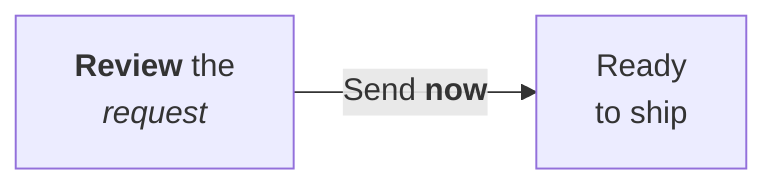

Repeated `linkStyle` declarations replace the earlier declaration for the same selector. Explicit edge selectors override the default declaration. This matches the pinned upstream engines; it does not use CSS property merging across separate linkStyle statements.

Automatic group compaction replans generated rank-skipping routes against final member positions. Bypass edges retain orthogonal endpoint legs and separate attachment points from adjacent direct edges in all four global directions. Authored ports and waypoints remain authoritative. Nested subgraph shells and shell endpoints use native compound geometry. Local directions are retained and applied; as in the documented source rule, a member connected outside its subgraph inherits the parent direction. The measured natural canvas preserves label size in compact scrollable hosts. Dense and manually positioned compound layouts still need their own qualification.

## Class Diagrams

Class diagrams are parsed into `MermaidClassDocument` and converted to topology previews with visible members, namespace groups, endpoint multiplicities, and UML inheritance, composition, and aggregation markers.

Supported class parsing includes:

- `classDiagram` headers.
- Global `direction LR`, `RL`, `TB` and `BT`, retained in `MermaidClassDocument.Direction` and applied to the native layout.
- `class Name` declarations.
- `class Name { ... }` member blocks.
- Class labels in `class id["Label"]` form. Backtick-quoted names stay atomic in declarations, member targets, relationships, multiplicities, lollipops, notes, safe links and class/direct style selectors; punctuation and literal tildes remain part of the identity.
- Class members added through blocks or `Class : member` statements.
- Annotations such as `<<interface>> ClassName`.
- Common relationship connectors such as inheritance, dependency, aggregation, composition, solid links, dotted links, and labels after `:`.
- Attached and floating class notes use typed `Notes` with source spans and visible native note surfaces. Generics keep a base stable identity and a display label such as `Store<Item>`; nested namespaces form real group shells. Two-way relationships preserve both endpoint markers.
- Shared safe class/direct paints, abstract/static member typography, labeled namespaces and typed lollipop occurrences reach native topology. Safe link data remains inert; unsupported presentation and callback declarations are diagnosed, and callbacks never execute.

```csharp
using ChartForgeX.Mermaid;

const string source = """
classDiagram
class User {
  +string Name
  +Login() bool
}
<<service>> User
User <|-- Admin : extends
""";

var result = new MermaidParser().ParseClass(source);
var document = result.Document;
var artifact = document!.ToVisualArtifact(new MermaidTopologyRenderOptions {
    Id = "class-map"
});
```

The conversion target for class diagrams is `TopologyChart`. Classes become topology nodes, class relationships become topology edges, and annotations, member counts, connectors, ids, and source spans are retained in the AST or topology metadata.

Class and namespace captions use the shared native text owner. Authored `<br>` forms become line breaks, entity escapes decode once, and backtick-wrapped Markdown emphasis becomes readable plain text with located `CFXM009`. Members retain abstract/static native typography. Authored rows in relationship captions and member or attribute details are measured and painted together with their native plate and node reservations. HTML and math remain literal text with `CFXM007`; callbacks never execute. The original captions and member source text remain in the AST and `mermaid.source.label` / `mermaid.member.source` topology metadata. Native nodes use the existing measured content sizing; explicit native label line limits still apply.

Balanced comma arguments such as `class Pair~K,List~V~~` are a ChartForgeX extension, reported with `CFXM009`. The stable identity is `Pair`, the native caption is `Pair<K,List<V>>`, and `mermaid.generic.source` retains the authored declaration or relationship endpoint. Generic references preserve an explicit class display alias. The same comma-extension warning policy applies to declarations, member references and both relationship endpoints, including lollipop interfaces. [Mermaid's Class documentation](https://mermaid.js.org/syntax/classDiagram.html#generic-types) lists comma generics as unsupported; this extension is not Mermaid 12.2 compatibility. Type names, nested tilde arguments and comma separators form a finite grammar bounded by the request nesting policy and a maximum of 128 nested type arguments. Empty, unbalanced or ambiguous generic declarations report `CFXM008` without a partial artifact. Quotes, expressions and wildcard type arguments are outside this generic grammar.

Migration: comma-generic declarations previously remained unsupported statements. They now create their stable native class with a warning. `MermaidWarningPolicy.Reject` continues to reject them. Mixed Markdown text styles and reference-specific class layout remain qualification work.


## State Diagrams

State diagrams are parsed into `MermaidStateDocument` and rendered through the native topology model.

Supported state parsing includes:

- `stateDiagram` and `stateDiagram-v2` headers.
- Global `direction LR`, `RL`, `TB` and `BT`, applied to native node ordering. State direction values are case-insensitive and retained in canonical uppercase form.
- State declarations including `state "Label" as id`, `state id as "Label"`, and `state id <<choice>>`.
- Composite state blocks in `state id { ... }` form.
- Transitions using `-->` with optional labels after `:`.
- Start and end markers using `[*]`.
- Attached and floating notes use typed `Notes` and visible native annotation surfaces. Attached multiline bodies preserve literal content through `end note`, including arrows, colons and accessibility keywords. `note "text" as ID` creates an independent named note, with `Id` set and `NodeId` null; it creates no state or transition.
- Composite groups preserve nesting and local directions; transitions can target their boundaries. Choice nodes omit captions, and fork/join nodes use native synchronization bars.
- `--` inside a composite starts the next concurrent region. `Regions` retains ordered `MermaidStateRegion` identities; child states refer to their region through `RegionId`, and `[*]` start/end markers are scoped separately to each region.
- Shared safe class/direct paints apply to declared states and explicit composites. Notes keep their native themed surface; note class/style targets and unsupported note forms remain diagnosed.

```csharp
using ChartForgeX.Mermaid;

const string source = """
stateDiagram-v2
direction LR
[*] --> Idle
Idle --> Processing : submit
state Processing {
  [*] --> Validating
  Validating --> Done
  --
  [*] --> Auditing
  Auditing --> Recorded
}
Processing --> [*]
""";

var result = new MermaidParser().ParseState(source);
var document = result.Document;
var svg = document!.ToSvg();
```

The conversion target for state diagrams is `TopologyChart`. Composite states become nested groups, states become nodes, and transitions become directed edges. Concurrent regions use the generic native compartment presentation with dashed separators. For TB/BT flow, regions form source-ordered columns with vertical separators; for LR/RL flow they form rows with horizontal separators. Reversing state ranks does not reverse the authored region order. Attached notes occupy measured gutters, local directions control their region or composite, and transitions to a composite retain its outer shell as the endpoint.

Named floating notes use the shared right gutter in source order, including notes authored within a composite or concurrent region. They have no attachment leader and do not alter region membership, state identity or transition facts. Their text, authored identity and source span remain in `MermaidDiagramNote`, while the existing topology semantic envelope preserves note identity and complete visible text. A State diagram can contain only notes without fabricated states. Native gutters, text wrapping, semantic regions, SVG, PNG and natural canvas bounds all use the existing topology annotation owner.

The supported floating form is one physical source line with a complete double-quoted caption, `as`, and one unquoted identity without whitespace or diagram delimiters. `\n`, `\"` and `\\` within the caption produce line breaks, quotes and literal backslashes; other text remains literal. HTML, Markdown and math are not activated inside note bodies. Duplicate note identities, identities shared with a state/composite, and transitions to a named note report located `CFXM008` and prevent artifact creation. Other unsupported note forms retain `CFXM007`. Captured source, element, output and raster limits still apply.

For programmatic notes, the existing four-argument `MermaidDiagramNote` constructor retains `Id == null` and automatic native identity. The five-argument overload accepts an authored `id`; the read-only `Id` survives native conversion and JSON export. Reserve a distinct identity when adding a note through the typed API. Generated note, concurrent-region and edge identities avoid authored note identities.

Migration: floating notes previously appeared only as retained statements with `CFXM007`. Supported named notes now appear in `Notes` and native output without that warning. Note style inheritance, transitions to notes and exact reference placement are outside this static mapping.

Empty leading, adjacent and trailing regions keep their typed identity and positive layout space without invented states or captions. This is the native empty-region policy; exact reference orientation and empty-region appearance remain qualification limits. A separator outside a composite, unclosed notes/composites and stray terminators report `CFXM008` and prevent shared rendering.

State diagrams use the shared safe `classDef`, `class`, inline `:::` and direct `style` paint declarations. Direct `fill`, `stroke` and `color` values override named classes; named classes override the default class for ordinary states. Composite groups accept explicit paints while synthetic concurrency regions, notes and pseudo-state controls retain their native presentation. Unknown targets and unsupported CSS remain diagnosed. These declarations do not inject CSS or execute source callbacks.

Explicit composite paints are a CFX extension: upstream Mermaid documents limitations on styling composite states. The current pinned State reference fixture checks top-level paints and an unstyled composite; it does not establish matching composite-style behavior across upstream versions.

## Entity Relationship Diagrams

Entity relationship diagrams are parsed into `MermaidEntityRelationshipDocument` and converted to topology previews.

Supported ER parsing includes:

- `erDiagram` headers.
- Global `direction LR`, `RL`, `TB` and `BT`, retained in `MermaidEntityRelationshipDocument.Direction` and applied to the native layout.
- Entity declarations discovered from relationship rows.
- Entity blocks in `ENTITY { ... }` form.
- Attribute rows with type, name, optional key markers, and optional comments.
- Crow's-foot connectors such as `||--o{`, `}|..||`, and related solid/dotted combinations.
- Relationship labels after `:`.
- Shared safe `classDef`, `class` and `style` paints; presentation statements do not become entity identifiers. Unsupported CSS remains diagnosed.

```csharp
using ChartForgeX.Mermaid;

const string source = """
erDiagram
CUSTOMER ||--o{ ORDER : places
ORDER {
  string id PK
  string customerId FK
}
""";

var result = new MermaidParser().ParseEntityRelationship(source);
var document = result.Document;
var artifact = document!.ToVisualArtifact();
```

The conversion target for ER diagrams is `TopologyChart`. Entities become database-like topology nodes. Relationships use identifying or dashed non-identifying lines with visible crow's-foot endpoint cardinality. Entity attributes, keys, and comments appear inside the entity boxes.

ER `subgraph` boundaries retain source-ordered membership and local directions in nested native groups. Relationships can target declared group boundaries. Forward shell references keep their inline classes and direct paints when the group is declared; later group styles retain precedence. Group identities remain relationship endpoints without fabricated entities. Dense container routing remains a separate visual qualification boundary. Unclosed entity/subgraph blocks and stray closing statements report `CFXM008`. The pinned Mermaid 10 reference interprets ER direction and subgraph words as entity names, while the 11/12 references recognize their newer notation. Shared expectations record that semantic difference; ChartForgeX follows the documented current notation.

ER names, aliases, group headers, relationship captions and attribute comments share safe native caption lowering. `<br>` becomes a line break and entities decode once. Markdown emphasis, including unwrapped ER emphasis, becomes plain text with located `CFXM009`; HTML and math remain inert literal text with `CFXM007`. Stable identities, authored captions, attribute fields and comments stay in the AST and topology metadata. JSON interchange preserves those facts through its existing semantic envelope; it does not reconstruct a mutable topology chart. Edit the typed document or native chart and export again to change the rendering.

ER direction values are case-insensitive and retained in canonical uppercase form. A bare `direction` identifier remains an entity or state. ChartForgeX also preserves its existing bare style/note keyword identifiers; some upstream grammars reserve those words, depending on family and source ending. Class source direction values use the documented uppercase forms.

## Requirement Diagrams

Requirement diagrams are parsed into `MermaidRequirementDocument` and converted to topology previews.

Supported requirement parsing includes:

- `requirementDiagram` headers.
- Optional `direction` statements.
- Requirement blocks including `requirement`, `functionalRequirement`, `interfaceRequirement`, `performanceRequirement`, `physicalRequirement`, and `designConstraint`.
- Requirement fields for `id`, `text`, `risk`, and `verifymethod`.
- Element blocks with `type` and `docref`.
- Relationship rows such as `element - satisfies -> requirement` and reverse-arrow variants.
- Shared safe `classDef`, `class`, direct `style` and inline `:::class` paints, with native requirement fact rows and located unsupported-CSS diagnostics.

```csharp
using ChartForgeX.Mermaid;

const string source = """
requirementDiagram
direction LR
functionalRequirement auth_req {
  id: "AUTH-1"
  text: Users must authenticate.
  risk: Medium
  verifymethod: Test
}
element auth_service {
  type: service
  docref: "Auth service"
}
auth_service - satisfies -> auth_req
""";

var result = new MermaidParser().ParseRequirement(source);
var document = result.Document;
var artifact = document!.ToVisualArtifact(new MermaidTopologyRenderOptions {
    Id = "requirements"
});
```

The conversion target for requirement diagrams is `TopologyChart`. Requirements and elements become topology nodes, relationships become directed topology edges, and requirement ids, types, risk, verification method, document references, classes, and source spans are retained in the AST or topology metadata.

Requirement source accepts literal `themeVariables.requirementBackground`, `requirementBorderColor`, `requirementTextColor`, `relationColor`, `relationLabelColor` and `relationLabelBackground`. These values map to the existing native node, line, text and label-surface paints. An explicit host theme selects unconfigured paints and preset defaults; explicit source role colors remain authored, and per-node styles remain more specific. Invalid color values produce located diagnostics. This is native color mapping, rather than execution of Mermaid CSS or a promise of identical preset typography.

## Architecture Diagrams

Architecture diagrams are parsed into `MermaidArchitectureDocument` and converted to topology previews.

Supported architecture parsing includes:

- `architecture-beta` headers.
- `group id`, `group id(icon)`, `group id[Title]` and combined declarations.
- `service id`, `service id(icon)`, `service id[Title]` and combined declarations.
- Optional `in parent` placement for services, junctions, and nested groups.
- `junction id` declarations.
- Edges using `-->`, `<--`, `<-->`, and `--`.
- Native endpoint ports such as `service:R --> L:database`, with the authored `L`, `R`, `T` or `B` side preserved when an arrow is reversed.
- Group-boundary edge modifiers such as `database{group}`.
- Source spans and raw statements for diagnostics and future fidelity work.

```csharp
using ChartForgeX.Mermaid;

const string source = """
architecture-beta
group api(cloud)[API]
group private(server)[Private API] in api
service gateway(server)[Gateway] in api
service db(database)[Database] in private
junction split in api
gateway:R --> L:split
split:R --> L:db{group}
""";

var result = new MermaidParser().ParseArchitecture(source);
var document = result.Document;
var artifact = document!.ToVisualArtifact(new MermaidTopologyRenderOptions {
    Id = "service-architecture"
});
```

The conversion target is `TopologyChart`. Services and junctions retain their node identities; groups use native `ParentGroupId` hierarchy. Actual nesting uses the existing compound layered layout, while shallow diagrams retain DenseGrouped. Authored endpoint sides map to the existing native ports. A `{group}` modifier routes through the service or junction's immediate containing group, using the shared group endpoint geometry; an ungrouped endpoint remains its real node. Reversed arrows preserve the corresponding endpoint's side and modifier. Repeated edge occurrences keep their source order and separate native edge identities. The raw AST, operators, membership and source spans remain inspectable.

Boundary edges carry the original flagged service/junction ID in `mermaid.source.id` or `mermaid.target.id` metadata. This intentionally replaces the former fabricated hidden `mermaid-architecture-group-anchor-*` nodes. Consumers should inspect the edge's actual group endpoint plus its raw source metadata instead of depending on synthetic anchor IDs. No public type or option changes are required. Cross-kind ID collisions, invalid explicit sides and a boundary modifier that stays within the same nonnull containing group produce located errors. A modifier with an ungrouped endpoint and cross-nested-group references remain accepted.

`architecture-native-boundaries.mmd` supplies one complete nested source for native, direct/fenced, portable, gallery and browser/reference contracts. These contracts require current-candidate execution. Native containment and port meaning do not promise Mermaid pixel geometry: its pinned SVG owner adjusts flagged service endpoints by padding. Explicit `align row`/`align column` declarations map to bounded native Layered constraints. Broader icon presentation remains a separate mapping; unsupported statements retain diagnostics. This mapping adds no browser layout engine, icon fetch or second renderer.

Optional captions remain absent in the typed `Title` string as an empty value. Native groups and services keep their source ID as a semantic label and set `ShowLabel = false`; the ID is not fabricated as painted text. Existing `TopologyNode.ShowLabel` and generic `TopologyGroup.ShowLabel` retain icons, surfaces, containment and accessible/portable labels while suppressing title/subtitle paint. Group header measurement releases caption space without removing icon/status reservations. The group flag defaults to true, and portable JSON emits `showLabel` only for false; readers of older omitted-field data retain visible captions. Explicit quoted empty captions use `[""]` or `['']`; unquoted `[]`, malformed parentheses and trailing declarations are errors. Quoted captions preserve primary closing-bracket and escaped-quote behavior.

Only explicit source `database`, `server` and `cloud` icons map to the existing native catalog IDs `common:database`, `common:server` and `cloud:cloud`. Source tokens remain in the AST and metadata. `disk`, `internet`, external packs and other names retain located `CFXM007` diagnostics and generic native surfaces without fetched or fabricated artwork. Their native equivalence remains unqualified. This intentionally replaces old unresolved `mermaid:*` IDs and first-letter icon guesses for those source declarations; consumers should use the resolved catalog identity and retained `mermaid.icon` source token. Quoted text-icon syntax remains a further grammar/presentation boundary.

`architecture-optional-captions.mmd` is the maintained source for optional captions, all three native built-ins and nested containment. The earlier boundary fixture uses the supported `server` icon for its gateway; unimplemented icons have separate diagnostic controls. Native/direct/fenced/portable/gallery and browser/reference contracts require current-candidate execution. Authored contracts do not qualify reference geometry or version outcomes.

### C4 source typography, palette and spacing

C4 configuration uses the same native typography and topology owners as direct C# diagrams. The source keys `<type>FontFamily`, `<type>FontSize`, `<type>FontWeight`, `<type>_bg_color` and `<type>_border_color` apply independently to `person`, `system`, `system_db`, `system_queue`, `container`, `container_db`, `container_queue`, `component`, `component_db` and `component_queue`, including their `external_` forms. Font sizes are finite logical pixels (numbers or `px` strings); weights accept native numeric weights and `normal`, `bold`, `bolder` or `lighter`. Native heading emphasis and relative subtitle proportions remain. Font stacks select locally available or registered faces; they never fetch fonts. A host `FontFamily` or `FontSize` override wins source typography, and explicit `UpdateElementStyle` paint wins the per-type palette.

`boundaryFontFamily/Size/Weight` and `messageFontFamily/Size/Weight` use the native group-header and relationship-label allocations. These are measured before routing and captured with the prepared scene. Prepared output retains the accepted face after the source model or registry changes; a newly prepared scene observes the new policy.

`c4ShapeMargin`, `nextLinePaddingX`, `diagramMarginX` and `diagramMarginY` lower to the generic bounded `GroupGrid` policy, with row limits from the existing source `UpdateLayoutConfig` owner. The pinned renderer reads row limits from its diagram database; its identically named `c4ShapeInRow`/`c4BoundaryInRow` configuration declarations do not update that database and remain retained with an unsupported-configuration warning. `width`, `c4ShapePadding` and `wrap` select the shared measured content allocation. Natural output grows its frame and node height at the configured wrap width rather than reducing the readable font floor; fixed viewport output retains its explicit frame scaling contract. Explicit row ceilings and fixed actor-caption allocations remain bounded and can report an overflow diagnostic. Native wrapping is grapheme-safe; upstream's soft unbreakable-word overflow is not a pixel-identity contract.

The pinned shared C4 node label helper consumes `width` and `c4ShapePadding`; its `height`, `boxMargin` and `wrapPadding` declarations do not supply additional node geometry. Those settings remain retained with an unsupported-configuration warning. Relative CSS font units, external sprite packs and shadow effects are not converted to native equivalents. The source fixture `c4-config-typography-native.mmd` is shared by the gallery, direct/fenced native tests, public consumer and browser/reference validation. Parser acceptance, native captures and actual external rendering are separate proof stages.

## C4 Diagrams

C4 diagrams are parsed into `MermaidC4Document` and rendered as a native topology hierarchy.

Supported C4 parsing includes:

- `C4Context`, `C4Container`, `C4Component`, `C4Dynamic`, and `C4Deployment` headers.
- `title` and `direction` statements.
- People, systems, containers, components, database variants, queue variants, and external variants.
- Enterprise, system, container, generic boundary, and deployment-node boundary calls with nested block membership.
- Relationship calls including `Rel`, `BiRel`, directional `Rel_U`/`Rel_D`/`Rel_L`/`Rel_R` aliases, and `Rel_Back`.
- Nested boundary/deployment membership becomes actual native group hierarchy; dynamic relationships retain source order and visible sequence numbers.
- `UpdateElementStyle` applies background, font and border colors, finite native shape keywords, technology text and explicit native legend labels; `UpdateRelStyle` applies line/text colors and finite label offsets to existing targets. Safe links remain data for the native artifact.
- `UpdateLayoutConfig` applies positive shape and boundary row limits through the existing native `GroupGrid` owner. Source order and nested containment remain native geometry; diagrams can grow beyond a compact viewport.
- Shape selection follows explicit shape, sprite keyword, comma-separated tag keyword and the existing element surface. Supported keywords are `person`, `box`, `rounded`, `cylinder`, `database`, `db`, `queue`, `pipe` and `component`.
- Source spans and retained warnings identify unsupported shadows, arbitrary shape tokens, boundary shape updates and external sprites. External artwork is not fetched. `AddElementTag` and `ShowLegend` are not part of the pinned grammar and remain retained statements.

```csharp
using ChartForgeX.Mermaid;

const string source = """
C4Container
title Container View
System_Boundary(bank, "Bank") {
  Person(customer, "Customer", "Uses online banking")
  Container(web, "Web Application", "ASP.NET", "Provides banking features")
  ContainerDb(db, "Database", "SQL", "Stores account data")
}
Rel(customer, web, "Uses", "HTTPS")
Rel_D(web, db, "Reads and writes", "SQL")
UpdateElementStyle(web, $shape="component", $legendText="Web tier")
UpdateElementStyle(db, $shape="database", $legendText="Data tier")
UpdateLayoutConfig($c4ShapeInRow="2", $c4BoundaryInRow="1")
""";

var result = new MermaidParser().ParseC4(source);
var document = result.Document;
var artifact = document!.ToVisualArtifact(new MermaidTopologyRenderOptions {
    Id = "c4-container"
});
```

The conversion target for C4 diagrams is `TopologyChart`. Boundaries and deployment nodes become nested groups, elements become nodes, and relationships become edges with supported native port hints, paint and label offsets. Kinds, descriptions, technology labels, tags, authored relationship indices and source spans remain inspectable. C4 reports `CFXM009` because native layout does not reproduce its specialized reference layout; explicit row limits and representable shape tokens do not establish reference wrapping or dense-pose identity. Source legend text/sprite fields are stored but not painted by the pinned reference; ChartForgeX projects explicit legend labels through its native legend owner. Unknown external legend sprites remain metadata with diagnostics. Unconfigured C4 documents keep their incumbent layout. Other C4 family configuration keys remain retained unless separately documented.

## Mindmaps

Mindmaps are parsed into `MermaidMindMapDocument` and converted to ChartForgeX's native mind-map topology layout.

Source indentation determines parent/child depth independently of the indentation width. A node keeps its generated stable `Id` for hierarchy links and its optional authored prefix as read-only `SourceId`. The original caption, shape, classes, icons and physical source span remain inspectable. The topology node metadata retains these source facts separately from its displayed caption.

Native surfaces follow the authored delimiters:

| Source | Native surface |
| --- | --- |
| `id[Caption]` | Rectangle |
| `id(Caption)` | Rounded rectangle |
| `id((Caption))` | Circle |
| `id{{Caption}}` | Hexagon |
| `id(-Caption-)` | Cloud |
| `id)Caption(` | Shared twelve-point `TopologyNodeShape.Burst` |
| `Caption` | Rounded rectangle |

Double quotes protect literal delimiters and modifier tokens inside a caption. Backtick-wrapped Markdown labels, including physical newlines, use the shared safe caption owner: safe strong/italic runs, authored breaks and text entities become measured native captions. HTML and math remain literal text with `CFXM007`; the renderer does not activate HTML or a math engine.

Class and icon modifiers may follow a node or appear on their own following line. Standalone modifiers belong to the preceding node and do not create a node or alter its structural depth. `:::highlight` maps deliberately to native selected-node stroke emphasis and reports `CFXM009`. Other class names are retained with a located `CFXM007`; external CSS and `classDef` grammar have no native mapping here.

`::icon(common:database)` resolves an explicit qualified id from the built-in topology catalog. The first resolved built-in marker paints an icon; further resolved markers remain metadata with `CFXM009`. Unqualified names, Font Awesome class strings and external pack ids remain inert with located `CFXM007` diagnostics. Source text cannot register icon packs, run CSS, or fetch assets. The source id or caption never supplies an inferred infrastructure glyph.

```csharp
using ChartForgeX.Mermaid;

const string source = """
mindmap
  root(("`**Roadmap**<br>service #38; data`"))
    plan("`**Plan**<br>next step`")
      :::highlight
      ::icon(common:application)
      store[Data]::icon(common:database)
    review{{Review}}
    ideas(-Ideas-)
    alert)Attention(
""";

var result = new MermaidParser().ParseMindMap(source);
var document = result.Document!;
var chart = document.ToTopologyChart();
var png = chart.ToPng();
```

The conversion target remains `TopologyChart` with `TopologyLayoutMode.MindMap`. Authored shapes, glyphs and complete captions use the existing measured layout, contour attachments and shared SVG/PNG scene. Malformed quotes, delimiters and modifiers produce located `CFXM008` errors and no direct or fenced artifact. Captured source, element, edge, depth, raster and output budgets still apply; class and icon facts count toward the element budget.

Migration: earlier Mindmaps painted generic Hub/Branch cards and an inferred root symbol while retaining authored shapes only as metadata. The default now paints the authored surface and only explicitly requested built-in icons. `MermaidMindMapNode.Text` retains the source Markdown wrapper; the native topology label exposes its lowered display text. Existing four-argument node constructors keep `SourceId = null`; the five-argument overload supplies an authored prefix. Hosts that require their own icon, emphasis or card treatment can edit the resulting topology through its normal API. `Burst` is appended to the shared shape enum without renumbering existing values; older interchange readers reject its unknown shape token under their existing validation contract. The interchange schema version and serializer remain unchanged.

The maintained `mindmap-native-notation.mmd` fixture supplies compact/wide and light/dark gallery, native and browser proof paths. External CSS/icon-pack adapters, mixed-style Markdown typography and deep/dense reference-layout qualification remain separate work.

Use frontmatter or an init directive to choose depth coloring:

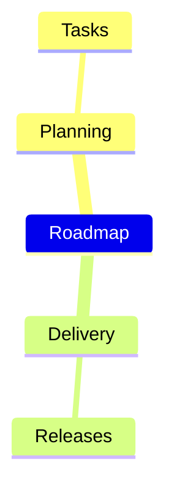

The root has its own color section. Branch mode gives each first-level branch and its descendants one section; depth mode counts parent-child relationships, so uneven indentation widths do not affect the colors. Both modes cycle through eleven non-root sections, and each incoming edge uses its child's section. The active `VisualTheme` supplies the colors; a shorter palette cycles through its own colors without changing the hierarchy or section assignments.

For direct conversion, set `document.ColorBy = MermaidMindMapColorMode.Depth`. The resulting topology retains palette indexes, so changing its `Theme` or `ThemeMode` resolves the new palette when it is prepared again. Explicit node or edge `Color` takes precedence, explicit node `BackgroundColor` remains its surface, and status badges retain health colors. Mindmaps use the native tinted mind-map style; set `DefaultRenderOptions` or pass topology render options to choose another treatment. Built-in explicit icon ids and the documented highlight mapping share this treatment; external class and icon tokens stay inert source metadata.

## Tree View Diagrams

`MermaidTreeViewDocument` lowers to the reusable core `TreeViewBlock`. Native directory rows retain source order, measured captions, descriptions, parent connectors and explicit file/directory meaning in SVG and PNG. Use `ToTopologyChart` only when a topology projection is the desired output.

The parser accepts indentation with spaces or tabs, quoted labels with escaped quotes and backslashes, and standard or heavy Unicode box-drawing prefixes. Source spans still refer to the original characters. A trailing `/` declares a directory, including an empty directory. Parent rows without a slash also receive directory presentation when they have children.

`##` introduces a description, `:::highlight` paints a theme-aware highlight, and `icon(file)`, `icon(folder)`, `icon(none)` or `icon()` selects a built-in icon or hides it. An explicit icon is independent of `treeView.showIcons`, which defaults to false. The host's nullable `ShowIcons` overrides that source setting. Descriptions appear beside a label when both complete strings fit; otherwise they receive a separate row line. Long text can shorten while its complete source remains in the row title and model.

```csharp
using ChartForgeX.Mermaid;

const string source = """
treeView-beta
Source/
├── Engine.cs :::highlight ## Native render entry
└── README.md icon(file) ## Public usage
""";

var parsed = new MermaidParser().ParseTreeView(source);
var artifact = parsed.Document!.ToVisualArtifact(new MermaidTreeViewRenderOptions {
    Id = "source-tree",
    Title = "Source tree",
    Width = 720,
    Height = 320,
    ShowIcons = true
});
```

`Width` is fixed and `Height` is a minimum natural height. The renderer measures enough height for readable rows and uses the shared artifact sizing/export/resource policy. Native limits are 10,000 rows, 128 levels and an 8,192-pixel frame per axis. Deep indentation that leaves no useful caption width rejects; a manually reduced frame rejects rather than dropping rows or shrinking text. Remeasure a direct `TreeViewBlock` with `WithNaturalSize` after editing its rows, typography, width or padding.

Other class names remain typed inert metadata with `CFXM007`; no external CSS applies. Unknown icon references retain their original names, emit `CFXM007` and use a local question mark without fetching an icon pack. Filename/extension icon maps, external icon libraries, arbitrary row/theme configuration and exact upstream browser paint remain outside this increment. Portable JSON carries typed `TreeView` rows and complete native presentation in the existing version-1 envelope. Item IDs retain their original values and obey the existing interchange limit of 512 characters, which is stricter than the native authoring limit. Parent preorder, depth, row count, text, spacing and frame limits validate before an imported native block is returned. External class/icon metadata remains inert after import.

```csharp
using ChartForgeX.VisualArtifacts;

var envelope = VisualArtifactInterchangeEnvelope.FromJson(artifact.ToInterchangeJson());
var imported = envelope.ToTreeViewBlock();
imported.AddItem("notes", "Notes.md", imported.Items[0].Id, "Imported rows remain editable");
imported.WithNaturalSize(720, 320);
```

Import creates a new row collection and preserves immutable rows and themes, configured padding, host-frame ownership, icons, source order and accessibility. Source-language identity and extension metadata remain on the envelope. JSON does not reconstruct the original Mermaid source text or source spans. Older version-1 readers that do not recognize the TreeView family reject it; send the separately rendered SVG when those readers need a display fallback.

## Event Modeling Diagrams

`MermaidEventModelingDocument` converts to native `TopologyChart` swimlanes. Source order determines successive timeline ranks; frame numbers are unique identities, including leading zeroes, and are never numerically sorted. Namespace/band pairs reuse one lane. UI/Automation lanes appear first, Command/Read Model lanes next, and Events lanes last; namespace order within each band follows first appearance. Frames use measured factual cards, without inferred infrastructure icons or domain calculations. Natural output retains complete cards; a compact `PreserveSize` HTML host can scroll the same diagram.

Use `tf`/`timeframe` and `rf`/`resetframe`, with entity kinds `ui`, `pcr`/`processor`, `cmd`/`command`, `rmo`/`readmodel` or `evt`/`event`. A reset suppresses its own inferred incoming relation and remains available as a source for subsequent frames. An ordinary frame without explicit sources takes the nearest earlier frame from a different namespace/band lane. Consecutive frames in the same lane do not invent a relation. Explicit sources repeat `->> number`; they resolve to existing frames, suppress default inference and obey the source/target kind rules. Source and target IDs remain unchanged in native edges and portable topology.

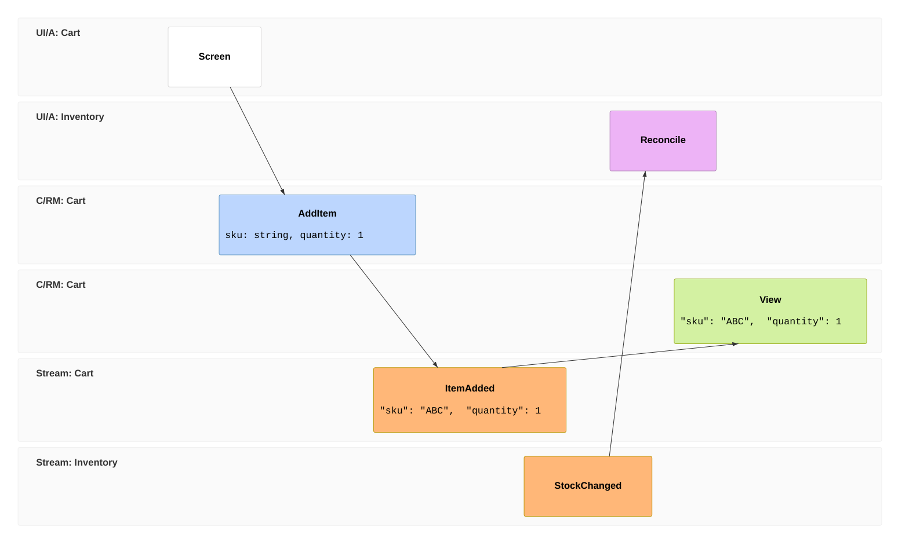

Inline data and `data identifier` blocks retain their complete body, type and source span. A missing reference, repeated block/frame identity, repeated/self source, malformed suffix or incompatible explicit source kind rejects with a location and produces no artifact. Ordinary identifiers use letter/underscore-leading segments containing letters, digits or underscores; namespace segments are dot-separated. Authored identities and derived native relation identities must fit the existing 512-character portable contract. Source frame numbers longer than three digits, comma/space source lists and inline data before a reference remain diagnosed `CFXM009` ChartForgeX extensions. Maintained source uses repeated arrows followed by a reference and inline body.

`json` data uses the shared strict finite JSON reader, preserving field order, number spelling, nested object/array structure, null and empty-string distinctions. A body can contain object members directly or a complete nested JSON object/array; retained wrapper braces are not discarded. Untyped schemas and `jsobj` use the existing bounded inert mapping reader: bare schema words such as `string` and `number` remain text. Nested paths use JSON Pointer escaping (`~0` for `~`, `~1` for `/`). Object and array rows describe their kind and count; they never become numeric chart observations. Prototype-shaped fields in a schema/`jsobj` mapping use a located literal fallback so they remain visible rather than being removed by metadata filtering; strict JSON retains those keys as inert data.

```csharp
using ChartForgeX.Mermaid;
using ChartForgeX.VisualArtifacts;

var parsed = new MermaidParser().ParseEventModeling(source);
var document = parsed.Document!;
// Existing TableArtifact columns are Field, Type and Value. Cells are inert
// display/export text, with explicit source-kind/path metadata.
var frameFacts = document.ToDataTable("20");
var blockFacts = document.DataBlocks[0].ToDataTable();
var artifact = document.ToVisualArtifact(new MermaidTopologyRenderOptions {
    Id = "cart-event-model", Width = 1200, Height = 700
});
var svg = artifact.ToSvg();
var png = artifact.ToPng();
var portable = artifact.ToInterchangeJson();
```

Each table conversion is detached and uses the existing Core `TableArtifact`; it does not add a table renderer or a host dashboard. Native frames lower the same facts through measured topology detail rows. Both inline and referenced data stay distinct when supplied together. Raw source/type/span metadata, frame and lane identities, reset markers and inferred/explicit relations survive existing topology interchange and subsequent native edits. Already captured envelopes remain snapshots. Portable string facts retain the existing 65,536-character interchange bound; oversized literal/data content reports a located resource-limit error before returning an artifact. The complete original document remains in `SourceText`. Optional whole-document artifact metadata is included only when it fits that same bound, so long comments do not prevent native rendering or portable export.

`text` bodies paint literally. `md`, `html`, `uri`, `figma`, `salt` and unknown formats paint as literal rows with located `CFXM007`; no HTML engine, JavaScript evaluation, remote asset or external data provider is activated. Unknown `entity`, `note` and `gwt` statement forms remain retained/diagnosed rather than becoming invented transitions or tables. Data blocks are opaque to shared configuration and accessibility prepasses, so data keys such as `accTitle` cannot alter the document.

Captured Mermaid element, edge, nesting, source, output and raster limits apply to parsing and direct table/native conversion. Values and expanded rows reserve capacity before row construction. Strict JSON depth also remains within the shared reader's 64-level bound. The existing native topology detail limit applies per frame; output/portable text limits remain shared. Duplicate JSON/map keys and non-finite values reject. Literal bodies still require balanced data braces and quotes. Theme-variable completeness, additional statement forms and actual platform/physical accessibility qualification remain separate boundaries. The maintained [complete native fixture](../ChartForgeX.Examples/Assets/Mermaid/eventmodeling-native-depth.mmd) supplies compact/wide light/dark gallery selections and ordinary Mermaid source downloads.

The source-order, reset and repeated-source rules follow the [pinned Mermaid 12.2 notation](https://github.com/mermaid-js/mermaid/blob/mermaid%4012.2.0/docs/syntax/eventmodeling.md) and [relation projection](https://github.com/mermaid-js/mermaid/blob/mermaid%4012.2.0/packages/mermaid/src/diagrams/eventmodeling/db.ts); the native factual-card geometry and typed-fact table conversion are ChartForgeX mappings.

## Kanban

`MermaidKanbanDocument` converts to `TopologyChart`: source-ordered columns use the shared `VerticalStack` group policy, and tasks use measured factual cards. Empty columns remain visible with a zero task count. Sparse and dense columns retain the same ordering; compact output keeps its natural geometry and can scroll in a `PreserveSize` HTML host.

Supported source uses one `id[Title]` declaration per line, with columns at one indentation and tasks at a deeper indentation shared within their column. IDs contain letters, digits, `_`, `-` or `.`, and must be unique across columns and tasks. Bracketed titles can be quoted; safe Markdown emphasis, entities and explicit line breaks use the shared caption lowering. Raw titles, declaration positions, source order and metadata blocks remain in native metadata and interchange.

Column and task metadata use one inline `@{ key: value }` block. `assigned`, `ticket`, `priority` and `label` have typed accessors backed by the existing metadata dictionary. `label` replaces the visible caption; the other fields paint as separate named facts. Priority remains authored text. Unknown fields, including external `icon` identifiers, also paint as literal facts and produce located `CFXM007`; they do not load assets or activate CSS. `=` separators remain a diagnosed `CFXM009` ChartForgeX extension; maintained source uses `:`. Quoted scalar values support commas, literal brackets and the existing JSON/single-quoted scalar rules. Objects, arrays, duplicate keys, malformed declarations and nested tasks are rejected with locations, without partial artifacts.

```csharp
using ChartForgeX.Mermaid;
using ChartForgeX.VisualArtifacts;

const string source = """
---
config:
  kanban:
    ticketBaseUrl: 'https://tickets.example.invalid/item/#TICKET#'
---
kanban
todo[To do] @{assigned: 'Delivery team'}
  docs[Write docs] @{assigned: 'Ana', ticket: 'CFX-1', priority: 'High'}
doing[In progress]
done[Done]
""";

var result = new MermaidParser().ParseKanban(source);
var document = result.Document!;
document.Columns[0].Tasks[0].Assigned = "Alex";
var artifact = document.ToVisualArtifact();
var html = artifact.ToHtmlPage(new VisualArtifactRenderOptions {
    HtmlSizing = VisualArtifactHtmlSizing.PreserveSize
});
```

`kanban.padding` accepts a finite non-negative number and maps to the existing native viewport padding. An authored source value takes precedence over the generic `MermaidTopologyRenderOptions.Padding`; omitted source retains that host option exactly. `kanban.sectionWidth` accepts any finite positive number and initializes the native column width and the task's available interior. For example:

```mermaid
---
config:
  kanban:
    padding: 36
    sectionWidth: 240
---
kanban
queue[Queue]
  review[Review] @{assigned: 'Avery Quinn', priority: 'High'}
empty[Empty]
```

Section width is a requested native lower bound, not a clipping rectangle: the shared 190-unit group minimum, 24-unit side gutters, measured headers and complete card facts can enlarge it. Very small positive values remain valid and grow through those same native owners. Tasks stay source-ordered in one vertical stack, including dense lanes; compact HTML retains natural geometry in a scrollable `PreserveSize` host. The source `padding` setting does not replace inner card gutters or inter-column clearances. Callers can edit the converted `TopologyChart.Viewport`, group widths and task content directly before preparing another native snapshot.

The maintained `kanban-source-geometry.mmd` example contains an empty lane and twelve dense ordered cards. Its complete `.csharp.txt` programs consume the ordinary `ChartForgeX.Mermaid` package and export the source, SVG, native PNG, script-free HTML and typed JSON from one artifact. The reference browser engine is test-only; these programs use normal native font resolution.

`kanban.ticketBaseUrl` accepts a safe absolute HTTP(S) template. The first `#TICKET#` marker is replaced with the encoded authored ticket, matching the source template contract; missing ticket values create no link. The existing URI owner validates targets. Without a configured template, ticket text stays visible and is not guessed to be a URL.

Each declaration allows at most 256 scalar metadata fields, each value at most 4096 characters, source IDs at most the native 512-character identity limit, and a full-fact metadata aggregate within the existing interchange text budget. Captured source, element, output-byte, raster-pixel and cancellation policies still apply. Native group/card edits reexport through the existing SVG/PNG/HTML and topology interchange owners; interchange snapshots remain detached. There is no separate Kanban serializer or host dashboard.

Migration: without an authored section width, native Kanban cards keep their initial 180-unit width rather than the old 132-pixel process-node preview. Source-sized cards use the requested column interior; both paths grow for complete captions and facts. Column headers retain authored line breaks, and metadata no longer collapses into a chosen assignee-or-ticket subtitle or an inferred health glyph. `TopologyGroupLayoutPolicy.VerticalStack` is appended to the shared enum; older interchange readers reject that unknown policy rather than silently changing layout. Arbitrary styling, external icon packs and upstream pixel-identical geometry remain outside this bounded mapping and retain diagnostics where supplied. The maintained `kanban-native-board.mmd` example includes empty, dense and sparse columns in compact/wide light/dark poses.

## Journey Diagrams

Journey diagrams are parsed into `MermaidJourneyDocument` and converted to the reusable native `JourneyDiagramBlock`.

Supported journey parsing includes:

- `journey` headers.
- Optional `title` statements.
- `section` groups.
- Scored task rows in `task: score: actor, actor` form.
- Source spans for sections and tasks.

```csharp
using ChartForgeX.Mermaid;

const string source = """
journey
title User Journey
section Start
  Open app: 5: User
  Find dashboard: 4: User, Analyst
""";

var result = new MermaidParser().ParseJourney(source);
var document = result.Document;
var artifact = document!.ToVisualArtifact(new MermaidJourneyRenderOptions {
    Id = "user-journey",
    Width = 960,
    Height = 560
});
```

`ToJourneyDiagramBlock()` retains ordered tasks and distinct section identities, including repeated display labels. Scores from one through five form a visible score path; actor rows show actual task membership. Non-finite or out-of-range task scores produce a located error, rather than an empty or misleading score chart. SVG and PNG use the same measured native scene. A task's `Section` references its typed `MermaidJourneySection`, rather than a section-name string. The former `ToChart()` score-bar projection and `SeriesName` option have been removed.

## Quadrant Charts

Quadrant charts are parsed into `MermaidQuadrantDocument` and converted to native ChartForgeX scatter charts.

Supported quadrant parsing includes:

- `quadrantChart` headers.
- Optional `title` statements.
- `x-axis low --> high` and `y-axis low --> high` labels.
- `quadrant-1` through `quadrant-4` labels.
- Point rows in `label: [x, y]` form, optionally `label:::class: [x, y]` with the source's four point styles.
- `classDef name color:#ABCDEF,radius:8,stroke-color:#123456,stroke-width:2px`; a later definition replaces the earlier declaration object, and direct point styles take precedence. The named `default` class is applied only when explicitly referenced.
- Quoted point labels and axis captions keep literal colons, `:::` and arrows.
- Separate native low/high axis labels at normalized `.25` and `.75` when paired; a low-only label uses `0` and a high-only label uses `.75`.
- Safe source dimensions, point radius, point/title font sizes, axis/title visibility, quadrant fills, point ink, X-caption ink and title ink through their native owners. Explicit host width/height take precedence over the corresponding source dimension.
- Source spans for labels and points.

Four native plot regions retain the authored quadrant captions, including charts without points. Region fills and caption contrast follow the active render theme when a host calls `WithTheme` or supplies a `VisualRenderContext`. Automatic accessible descriptions include the region captions; explicit host descriptions remain authoritative.

```csharp
using ChartForgeX.Mermaid;

const string source = """
quadrantChart
title Reach and Engagement
x-axis Low Reach --> High Reach
y-axis Low Engagement --> High Engagement
Campaign A: [0.3, 0.6]
Campaign B: [0.7, 0.8]
""";

var result = new MermaidParser().ParseQuadrant(source);
var document = result.Document;
var artifact = document!.ToVisualArtifact(new MermaidQuadrantRenderOptions {
    Id = "reach-engagement",
    Width = 960,
    Height = 560
});
```

The conversion target for quadrant charts is `Chart`. Axis labels, quadrant labels, point counts, source spans, and point labels are retained in the AST or artifact metadata. Static rendering maps Mermaid points to deterministic ChartForgeX scatter marks. Radius and pixel outline styles accept whole values from 0 through 1024 and solid hexadecimal colors. The AST retains raw point/class styles and statements. Bounded `mermaid.quadrant.sourceFacts` artifact metadata preserves the declarations and spans as inert facts; it is not a scalar-chart JSON rehydration contract.

Source settings without faithful native owners remain located warnings, including separate Y-caption ink, per-axis font sizes, region text ink, padding, axis sides and internal/external border configuration. Host `RegionBorder` and pivot options remain explicit native policies. Unknown source declarations remain diagnosed; `MermaidWarningPolicy.Reject` rejects their rendering.

`quadrant-point-styles` is the compiled Core-only native recipe. The showcase and ordinary adapter package probe share `Build/PackageConsumers/Adapters/quadrant-native-source-depth.mmd` for parsed-source proof. Neither source authoring nor these declared contracts alone establishes pinned browser qualification.

## Sequence Diagrams

Sequence diagrams are parsed into `MermaidSequenceDocument` and can be converted to `SequenceArtifact` for deterministic static previews.

Supported sequence parsing includes:

- `sequenceDiagram` headers and source `title` statements.
- Participant `box` groups with named, hexadecimal, RGB/RGBA and HSL/HSLA colors, plus explicit `create`/`destroy` lifetimes with delayed headers and bounded lifelines.
- Explicit `participant` and `actor` declarations.
- Participant aliases with `as`.
- Participant configuration objects with simple `type` and `alias` values.
- Implicit participants discovered through messages, notes, activations, and links.
- Message operators such as `->>`, `-->>`, `->`, `-->`, `-x`, `--x`, `-)`, and `--)`.
- The solid/dashed top/bottom filled and open half-arrow forms introduced in the Mermaid 12 grammar, including their reverse terminals. Exact operators remain available in message metadata.
- Message text after `:`. Participant, message, note, box and fragment captions use shared safe text: authored `<br>` breaks and character escapes become readable text; other HTML and math remain inert and diagnosed.
- Activation and deactivation shortcuts with `+` and `-` suffixes.
- `activate` and `deactivate` statements. A deactivation without an active participant is a located error; an activation can remain open at the end of the source.
- `Note right of`, `Note left of`, and `Note over` statements.
- `loop`, `alt`, `else`, `opt`, `par`, `par_over`, `and`, `critical`, `option`, `rect`, and `end` block statements.
- Source-ordered `autonumber`, `autonumber off` and resume controls. Explicit starts reset the next number and use a step of one unless a step is supplied; a bare control resumes the current counter and step. Hidden messages still advance the counter. Finite decimal values, complete token consumption and message-range overflow remain validated.
- Safe simple `link` entries, bounded `links` JSON menus and located `properties` JSON declarations. DOM-based `details` stays diagnosed and inert.

```csharp
using ChartForgeX.Mermaid;

const string source = """
sequenceDiagram
autonumber 10 0.5
participant U as User
actor API as Native API
participant DB {"type": "database", "alias": "Data Store"}
U->>+API: Request
activate API
API->>DB: Store
Note right of API: Processing
loop Every minute
  API-->>-U: Done
end
link API: Dashboard @ https://example.com/api
""";

var result = new MermaidParser().ParseSequence(source);
var document = result.Document;

var sequence = document!.ToSequenceArtifact(new MermaidSequenceRenderOptions {
    Id = "incident-sequence",
    Width = 960,
    Height = 560
});

var artifact = document.ToVisualArtifact();
var svg = document.ToSvg();
var png = document.ToPng();
```

The conversion target for sequence diagrams is `SequenceArtifact`. Participants, aliases, participant kinds, messages, notes, activations, block spans, autonumber settings, source lines, and actor links are retained as model data or metadata where the reusable artifact can carry them.

Source `dark`/`default` themes and font stacks become authored `SequenceArtifact.Theme` and `ThemeMode` defaults for SVG, PNG and HTML exports. The native sequence owner accepts the shared immutable `VisualTheme`, including its typography scale. A host that calls `Prepare(VisualRenderContext)` supplies that prepared scene's theme, mode and font. Explicit colors in `SequenceArtifact.Paint` remain authored presentation; null paint roles use the host theme. The portable envelope records the theme and authored role colors, and prepared snapshots detach those values.

Sequence source variables map to these existing native roles:

| Source `themeVariables` | `SequenceArtifact.Paint` roles |
| --- | --- |
| `actorBkg`, `actorBorder`, `actorTextColor`, `actorLineColor` | `ParticipantFill`, `ParticipantBorder`, `ParticipantText`, `Lifeline` |
| `signalColor`, `signalTextColor` | `MessageLine`, `MessageText` |
| `noteBkgColor`, `noteBorderColor`, `noteTextColor` | `NoteFill`, `NoteBorder`, `NoteText` |
| `activationBkgColor`, `activationBorderColor` | `ActivationFill`, `ActivationBorder` |
| `labelBoxBkgColor`, `labelBoxBorderColor`, `labelTextColor` | `FragmentFill`, `FragmentBorder`, `FragmentText` |

Colors use the shared native color parser, including HSL hue units and alpha. Source `rect` blocks paint real native backgrounds behind messages and annotations. They do not display their color value as a fragment header. Explicit block colors become `SequenceArtifactBlock.BackgroundColor`; an uncolored source rectangle uses authored `themeVariables.rectBkgColor`, then authored `actorBkg`, then the deterministic native translucent-gray fallback. Other fragment backgrounds remain null unless explicitly authored.

`sequence.showSequenceNumbers: true` forces message numbers to remain visible, including inside `autonumber off` sections. With that option false or absent, authored controls determine visibility. A new explicit start resets the step to one unless its declaration also supplies a step. Off/resume controls preserve the counter and step, and hidden messages advance the counter. Each resolved value stays associated with its message identity in native metadata and portable interchange. The established single leading `autonumber` form keeps its SVG and PNG output; portable source artifacts also record the resolved per-message values and visibility.

`MermaidSequenceDocument.AutonumberStatements` is the canonical ordered control collection. `Autonumber` is a read-only last-declaration view. Code that previously assigned `document.Autonumber` must add or edit a `MermaidSequenceAutonumber` in `AutonumberStatements` instead; its `Enabled` property represents off/resume visibility. This removes competing mutable owners while preserving the original statement spans and value spellings.

`par_over` retains a distinct `ParOver` kind in the typed document, native blocks and portable block/parent-branch facts. It accepts `and` branches through the same source-ordered fragment owner as `par`. Static output uses the existing measured parallel geometry and the visible `par` header. Overlapped branch placement remains unqualified; native output does not invent an overlap policy. The maintained nested source includes notes, activations, a critical branch and a terminal note-only branch.

Finite source spacing/wrap, actor/message/note typography, participant views and preset appearance map to the native sequence model. Other family options and theme variables retain located diagnostics; broader participant configuration and reference-specific geometry remain separate.

Single-line participant declarations accept attached or spaced `@{type: database, alias: Storage}` metadata through the existing shared metadata/scalar reader. JSON-quoted and YAML flow scalar forms are supported. The eight native kinds are `participant`, `actor`, `boundary`, `control`, `entity`, `database`, `collections` and `queue`; an external `as` alias takes precedence. `Configuration` retains the exact object syntax, including `@`. The existing bare-brace form and case-insensitive supported keys remain accepted. Unsupported fields and unknown kinds retain located diagnostics; malformed objects, scalar types or trailing text are errors. Physical multiline participant objects remain a further grammar boundary.

`MermaidSequenceDocument.PropertyStatements` is the canonical ordered collection of `MermaidSequenceProperties` declarations, carrying participant identity, raw JSON and source span. Literal string, finite numeric, boolean and null properties resolve in declaration order; later values replace earlier values with the same name. Every raw occurrence remains in the document and portable participant metadata. CSS classes, icon/artwork URLs and structured properties stay literal source data with `CFXM007`; no CSS, asset fetch, HTML or callback executes. `details` never resolves a DOM element or external data.

Menu/property JSON uses the existing strict bounded reader and rejects duplicate keys. Menu directives use their existing authored order. A `links` declaration with exactly one safe entry can provide the participant's static `Href`; a multi-entry declaration retains ordered host-facing data and clears that static target instead of choosing a primary link. A later simple `link` can provide its explicit safe target. Unsafe/empty entries and non-text URLs stay raw, diagnosed and inactive. The adapter uses the shared safe-link policy, which supports relative, HTTP, HTTPS, mailto and tel targets. `Href` is the sole static navigation target; existing `mermaid.link.label`/`mermaid.link.url` keys retain the last simple declaration as raw summary. It adds no menu UI. Portable participant metadata records ordered menu/property declarations and spans, safe menu entries and resolved scalar property values through the existing interchange JSON writer. Raw facts are checked before reader expansion, and composed values are counted before materialization against the existing 65,536-character text bound. A required value above that bound reports a located resource diagnostic; the full source/raw AST stays canonical and is not copied into an unbounded metadata value. Direct document conversion uses its captured resource policy.

Sequence HTML preserves its completed scene size so labels keep their logical font size on compact pages. A keyboard-accessible region scrolls horizontally when the scene is wider than its host. Prepared sequence artifacts use the same policy. This preserves scene geometry; it does not reflow messages or participant columns.

A host can choose page-width scaling explicitly, or request preserved size for another artifact family:

```csharp
var html = result.Artifact!.ToHtmlPage(new VisualArtifactRenderOptions {
    HtmlSizing = VisualArtifactHtmlSizing.FitToWidth
});
```

`Automatic` preserves sequence size and retains other families' existing standalone HTML sizing. `PreserveSize` uses the common scroll region for any supported artifact. These options affect HTML hosting; SVG and PNG exports keep their prepared geometry. Print output fits the scene to the available page width. To change layout or typography, supply those values when preparing the scene.

For a trusted SVG that has already been rendered, `artifact.ToWatermarkedHtmlPage(options, renderedSvg, watermark)` applies the same host sizing while preserving the supplied scene and adding the watermark. The overload without options uses automatic sizing.

## Pie Charts

Pie diagrams are parsed into `MermaidPieDocument` and converted to native ChartForgeX pie charts.

Supported pie parsing includes:

- `pie` headers.
- Optional `showData` on the header line or as a body statement.
- Optional titles on the header line (`pie title Output by surface`, `pie showData title ...`) or as `title` statements.
- Quoted slice labels with positive numeric values.
- Source spans for every slice.

```csharp
using ChartForgeX.Mermaid;

const string source = """
pie showData
title "Result Mix"
"Passed" : 1260
"Warnings" : 68
"Failed" : 10
""";

var result = new MermaidParser().ParsePie(source);
var document = result.Document;

var artifact = document!.ToVisualArtifact(new MermaidPieRenderOptions {
    Id = "result-mix",
    Width = 820,
    Height = 460
});

var svg = document.ToSvg();
var png = document.ToPng();
```

The conversion target for pie diagrams is `Chart`. Slice order, labels, values, `showData`, source lines, and slice counts are preserved in the chart model or artifact metadata.

## Timelines

Timeline diagrams are parsed into `MermaidTimelineDocument` and converted to the reusable native `TimelineDiagramBlock`.

Supported timeline parsing includes:

- `timeline` headers with optional `LR` or `TD` direction tokens.
- Optional `title` statements.
- `section` groups.
- Time-period rows in `period : event` form.
- Multiple inline events in `period : event : event` form.
- Continuation events on following lines starting with `:`.

```csharp
using ChartForgeX.Mermaid;

const string source = """
timeline TD
title Native Visuals
section OfficeIMO
Markdown AST : Visual fence blocks
section ChartForgeX
Artifacts : SVG preview : PNG preview
""";

var result = new MermaidParser().ParseTimeline(source);
var document = result.Document;

var artifact = document!.ToVisualArtifact(new MermaidTimelineRenderOptions {
    Id = "native-visuals",
    Width = 960,
    Height = 560
});

var svg = document.ToSvg();
var png = document.ToPng();
```

`ToTimelineDiagramBlock()` preserves categorical period labels, ordered event cards, multiline continuations, distinct sections and the requested reading direction. Labels such as `Before launch`, `2026` and `2026-10-22` remain categorical text; the renderer does not parse them into dates or invent numeric/calendar durations. Use Gantt when tasks need actual dated intervals. `<br>` line breaks are measured and wrapped by the shared native text owner. A period's `Section` references its typed `MermaidTimelineSection`. Whole words fit the measured section/period/event cells where possible. A single token that cannot fit the authored frame shortens with an ellipsis and retains its complete SVG title; the frame does not grow implicitly. The former `ToChart()` interval projection and `ShowEventDurations` option have been removed.

## Gantt Diagrams

Gantt diagrams are parsed into `MermaidGanttDocument` and converted to native ChartForgeX Gantt charts.

Input `dateFormat` fields include `YYYY`/`YY`, numeric and English named months, `D`/`DD`/`Do`, quarter `Q`, day-of-year `DDD`/`DDDD`, 12/24-hour clocks, `a`/`A`, and one to three fractional-second digits. Brackets quote literal text: `YYYY-[Q]Q` accepts `2026-Q2`, and `Do-MMMM-YYYY` accepts `2nd-January-2026`. Fully specified formats use an invariant English calendar; two-digit years `00` through `68` mean 2000 through 2068, and `69` through `99` mean 1969 through 1999. The same fields format dates for exclusion/inclusion matching. Input format text is limited to 256 characters.

Calendar dates use the configured input fields for parsing and normalization. Separate dates containing spaces with commas, for example `excludes 3rd January 2026, 4th January 2026` with `dateFormat Do MMMM YYYY`. Equivalent accepted spellings such as `03rd` and `3rd` match the same date, and UTC offsets compare their resolved instant. The configured format takes precedence when a value could also be read as an ISO date. ISO dates and whitespace-separated weekday lists remain available. General task-date fallback does not turn an unmatched calendar timestamp into a whole-day rule. Unix calendar matching retains all accepted `DateTime` ticks, including fractional milliseconds.

`X` means Unix seconds and `x` means Unix milliseconds for both start and end dates, including decimal fractions. They also compose with bracketed literals, such as `[epoch:]X` and `X[ seconds]`. Composed Unix formats identify complete instants without a date anchor and retain fractional ticks in exclusion/inclusion matching. Explicit `Z`/`ZZ` offsets normalize to UTC before scheduling. These documented meanings are retained where the reference engines disagree: Mermaid 11/12 interpret integer `X` starts as milliseconds while Mermaid 10 uses seconds; some fractional, offset-end and day-of-year inputs also resolve differently upstream. The corpus records reference outcomes separately from native expectations.

Input formats without a year require `MermaidParseOptions.GanttDateAnchor`. Month/day fields use its year; a day without a month also uses its month; time-only fields use its complete date. An authored month or quarter without a day starts on that month's first day. Formats with an explicit year default omitted month/day fields to January 1. The anchor's time and `DateTimeKind` are ignored. CLI validate, preview and export accept `--gantt-date-anchor YYYY-MM-DD`; the VS Code setting is `chartforgexMarkup.ganttDateAnchor`. Leap-day and day-of-year validation use the resolved year. The same policy applies to retained .NET/percent formats and calendar exclusions/inclusions; anchored dates are specific dates, while weekday and `weekends` rules recur.

Retained .NET formats with offset fields and complete ISO fallback values normalize authored offsets to UTC and expose `DateTimeKind.Unspecified`, matching Mermaid `Z`/`ZZ` input. Minute-precision ISO fallbacks accept offsets as well as seconds-bearing forms. Values without offsets retain their authored wall-clock fields. Parsing does not apply the host timezone. Mermaid tokens take precedence for ambiguous single-character formats; if that interpretation fails, a standard .NET format can still accept its textual date, such as `dateFormat M` with `February 29` and a leap-year anchor. Calendar exclusions and inclusions retain the interpretation selected while parsing, so native month/day rules match the day and native sortable timestamps retain their full clock fields.

Complete English fallback dates retain weekday prefixes and date/time commas. An implicit end such as `Second :Friday, 02 January 2026` inherits the preceding task's end as its start. When a weekday could also be a viable task ID, the explicit ID/start/end interpretation keeps priority so references such as `after Friday` remain valid. Use the configured `dateFormat` to disambiguate an explicit weekday-prefixed start.

```csharp
using System;
using ChartForgeX.Markup.Mermaid;
using ChartForgeX.Mermaid;

const string source = "gantt\ndateFormat MM-DD\nBuild :02-29,1d";
var context = new MermaidParseOptions { GanttDateAnchor = new DateTime(2028, 1, 1) };
var parsed = new MermaidParser().ParseGantt(source, context);
var rendered = MermaidRenderer.Render(source, new MermaidRenderOptions { ParseOptions = context });
var markdown = new MermaidVisualMarkupParser(new MermaidRenderOptions { ParseOptions = context });
```

Source rendering and Markdown fences use the same parser context; the Markdown adapter snapshots its options at construction. The document exposes `DateAnchor`, and portable artifacts retain it as `mermaid.dateAnchor`. An anchor does not supply a today line. Without an anchor, partial task inputs and calendar dates produce a located error. Complete ISO dates and recurring weekday/weekend rules remain accepted even under a yearless configured format. Configured calendar dates retain their resolved date even when the format omits a month or day; `YYYY-MM` identifies the first day of that month, rather than a recurring rule for every date in the month.

Migration: loose date parsing no longer fills missing fields from the system date. Use an explicit `dateFormat` and anchor for partial inputs. Complete legacy spellings remain accepted, including unpadded ISO dates, single-digit hours, English named-month dates, and numeric slash dates with four-digit years. Use the configured format for other spellings. Endpoints use the same anchor; a time-only end does not infer a following day or a following year.

Task dates can contain commas. With `dateFormat MMMM D[,] YYYY`, `Build :build,January 2, 2026,January 3, 2026` retains `build` as the ID and parses both complete dates. Configured timestamps can contain several commas, and numeric task IDs stay separate from numeric date fields. The final `dateFormat` applies even when declared after a task; sections and source locations retain their authored order.

Supported Gantt parsing includes:

- `gantt` headers.
- Optional `title`, `dateFormat`, `axisFormat`, `tickInterval`, `weekday`, `excludes`, `includes`, `weekend`, and `todayMarker` statements.
- `section` groups.
- Task metadata with optional tags: `active`, `done`, `crit`, `milestone`, and `vert`.
- Task ids used by `after taskId` start dependencies and `until taskId` end references. Multiple `after` ids select the latest end; multiple `until` ids select the earliest start. Both can reference later rows without changing the authored row order. Every distinct `after` predecessor has a native dependency connector.
- Explicit start/end dates using the configured `dateFormat`, including English month names, ordinals, quarters, day-of-year fields, two-digit years, clocks, fractions, UTC offsets and Unix timestamps.
- Axis labels use English D3 time directives: weekday/month names, day/year and week numbers, 12/24-hour clocks, fractions, padding modifiers, and `%%`. Text outside directives remains literal. The default is `%Y-%m-%d`, with time added for fixed sub-day intervals; input `dateFormat` and output `axisFormat` use separate notation.
- Durations using `ms`, `s`, `m`, `h`, `d`, `w`, `M`, and `y` units. `M` means calendar months; `m` means minutes.
- Milestones retain their authored start/end range and render as native ChartForgeX milestone points at the range midpoint.

For example, `Task :2026-01-31, 1M` ends on February 28, while `Task :2026-01-31, 1m` ends one minute after midnight on January 31. Calendar months and years clamp to the last valid day when necessary. Fractional months/years use the whole-number part; fractional days/weeks round to the nearest day. Clock durations retain millisecond precision. Excluded dates extend duration-based ends after that calculation.

ChartForgeX retains its existing case-insensitive clock-unit aliases, including `1H`, `1MS`, and `1 minute`, for source compatibility. These are ChartForgeX extensions to Mermaid shorthand. The calendar units `M` and `y` require an adjacent suffix and a complete numeric value, such as `1.5M`; forms such as `1 M`, `.5M`, and `1year` produce diagnostics.

```csharp
using ChartForgeX.Mermaid;

const string source = """
gantt
title Project Plan
dateFormat YYYY-MM-DD
axisFormat %m/%d
section Build
Design : active, des, 2026-01-01, 5d
Implement : crit, impl, after des, 7d
Ship : milestone, ship, after impl, 0d
""";

var result = new MermaidParser().ParseGantt(source);
var document = result.Document;

var artifact = document!.ToVisualArtifact(new MermaidGanttRenderOptions {
    Id = "project-plan",
    Width = 960,
    Height = 560,
    Today = new DateTime(2026, 1, 8)
});

var svg = document.ToSvg();
var png = document.ToPng();
```

The conversion target for Gantt diagrams is `Chart`. Task ids, tags, sections, dependencies, date format, axis format, tick interval, excludes/includes, weekend selection, today marker text, and source spans are retained in the AST or artifact metadata. Static rendering maps Mermaid tasks, milestones, dependencies, and optional caller-provided today markers onto ChartForgeX's dependency-free Gantt renderer. Duration-based and `until` scheduling ends advance over excluded dates, with includes overriding exclusions; explicit end dates remain authored dates. `End` supplies dependency scheduling, while `RenderEnd` preserves Mermaid's visible bar endpoint before trailing excluded days. Interior exclusions can extend both values. Repeated `excludes` and `includes` declarations merge their tokens, and the final diagram calendar/date format applies to all tasks regardless of declaration order. Missing ids, circular date dependencies and an end before its start produce source diagnostics. `UntilTaskIds` retains end references independently of `DependencyIds`, and the artifact records their count as `mermaid.untilReferences`.

Native callers attach their Gantt series, then use `chart.AddGanttDependency(predecessor, successor)` with retained handles for forward or multiple links. Both handles must be distinct Gantt series attached to that chart, including vertical markers. `chart.GanttDependencies` returns a detached snapshot with stable `PredecessorId` and `SuccessorId` values; duplicate links render once. The fluent `dependsOn` argument accepts an attached predecessor handle and registers the same chart-owned relationship. Moving a series preserves its links. Removing an endpoint removes its links, while clearing observations temporarily hides connectors until data is restored on the same handle.

Links between task rows anchor the predecessor's displayed finish and successor's displayed start without changing task dates. References involving a vertical marker retain their dependency metadata without a row connector. Milestone links meet the diamond boundary, and connectors paint above task fills so arrowheads remain visible in SVG and PNG. Automatic axis windows reserve room for endpoint arrowheads; explicit axis bounds retain their clipping window. Source metadata uses the current series ordinals for the rendered scene and stable IDs for dependency endpoints.

The `vert` tag paints a reference line at the entry's resolved start date without taking up a task row. Its full start/end range remains available to `after` and `until` scheduling and the automatic time window. Native callers use `chart.AddGanttMarker("Deadline", when, rangeEnd: optionalEnd)`; numeric schedules have the equivalent numeric overload. Accessible descriptions and interaction values identify the visible start position, while `data-cfx-end` retains the scheduling endpoint. Markers are hidden from the legend by default; opting one in with `chart.Series[index].WithLegendEntry()` uses the marker's actual point, series, status or default ink for its swatch. Ordinary `AddVerticalLine` annotations also render on classic Gantt and timeline charts through the shared annotation owner. Marker-only Gantt charts render guides and a time axis without inventing task rows. Captions use measured placement around task bodies; explicit axis bounds hide markers outside the window. Mermaid 10 interprets the tested unnumbered `vert` form as an ordinary task id; the versioned fixture records that semantic difference, while ChartForgeX follows the current 11/12 marker interpretation.

Today lines use only `MermaidGanttRenderOptions.Today`; rendering never reads the system clock. An authored `todayMarker off` suppresses that line even when the caller supplies a date; the control is case-insensitive. Native classic and packed Gantt today lines paint above task fills.

`todayMarker stroke-width:5px,stroke:#0f0,opacity:0.5` applies a five-pixel, translucent green stroke in SVG and PNG. Supported comma-separated declarations are `stroke`, `stroke-width`, `opacity`, `stroke-opacity`, and `stroke-dasharray`. Colors use native named or hexadecimal colors, or `none`; widths and dash lengths use plain chart pixels or `px`, up to 1,024 pixels. Dash lengths are space-separated numbers of at least 0.25 pixels, such as `6 2`; smaller patterns are rejected to bound raster work. `none` selects a solid line, including inside a host page with an inherited dash pattern. Opacities accept values from zero through one or percentages. Overall and stroke opacity multiply; the last valid value for each property wins. Unsupported properties, units, paints or values retain their source and emit `CFXM007`; supported declarations on the same line still apply. Declarations are limited to 4,096 characters, 64 properties and 32 dash lengths.

Callers can supply `MermaidGanttRenderOptions.TodayStyle` to override source styling with a native `ChartStrokeStyle`. Source `off` still suppresses the line. Native charts use `chart.Options.GanttTodayStyle` for classic and lane current-time guides; line annotations use `chart.Annotations[index].StrokeStyle`. The immutable style has optional color and width, an opacity multiplier and an optional dash pattern. Native widths range from zero through 1,024 chart pixels; dash lengths range from 0.25 through 1,024. These bounds keep the style valid under raster scaling. A null pattern retains the guide's default dash, while an empty pattern is solid. Automatic Cartesian axis ends reserve space for the painted line width when it fits within the plot, including horizontal bars and transformed scales. Each guide reserves only the space its own position and width require; a guide that already fits does not compress task or data geometry. Markers and reference lines share the same axis fit. Strokes wider than the plot clip independently without cancelling the gutters of smaller guides. Explicit axis ends retain their authored clipping boundary. Transparent, zero-opacity and zero-width strokes do not reserve boundary space; their captions remain available. Annotation band fills and caption styles retain their existing appearance.

For a milestone with a nonzero duration, `Start` and `End` retain the range used by Mermaid dependency calculations. Callers that previously treated `Start` as its rendered point should compute the midpoint of that range. Zero-duration milestones and their rendering retain the same date. Remaining calendar and chart work is tracked in the [support matrix](mermaid-support-matrix.md).

`tickInterval` accepts a positive integer followed by `millisecond`, `second`, `minute`, `hour`, `day`, `week`, or `month`, such as `2week`. `weekday tuesday` aligns weekly boundaries to Tuesday; the Mermaid default is Sunday. Ticks select calendar boundaries: `2day` selects days 1, 3, 5 and so on within each month, while `2month` selects January, March and so on within each year. A window without a matching boundary has no generated tick labels. Invalid interval spellings, counts above `Int32.MaxValue`, unsupported date windows, or intervals exceeding the native 2,000-tick budget use automatic ticks. Native callers use `WithGanttTickInterval(new ChartTimeTickInterval(ChartTimeTickUnit.Week, 2, DayOfWeek.Tuesday))`; explicit axis labels take precedence. Applied native millisecond intervals use date and time labels with millisecond precision so boundaries remain distinct across midnight. Mermaid adapters also select time-bearing defaults for fixed millisecond, second, minute and hour intervals; an authored `axisFormat` takes precedence. Automatic fallback retains its usual date labels, and caller formatters still take precedence. Gantt lane charts and numeric schedules retain their existing tick behavior.

`axisFormat %a %d %b` displays labels such as `Sun 04 Jan`; `%I:%M:%S.%L %p` displays `01:05:06.007 PM`. `%U` and `%W` number weeks from Sunday and Monday, and `%V` with `%G` uses ISO week/year numbering. `%_d`, `%-d` and `%0d` choose space, no or zero padding. Composite `%c`, `%x` and `%X` use the reference formatter's English US defaults. Native Gantt dates use UTC interpretation by default. `WithXAxisTimeScale(displayZone)` applies the selected zone to both tick alignment and calendar labels, including `%Z` and daylight-saving offsets. Epoch directives `%Q` and `%s` always describe the underlying UTC instant. Changing the host display zone after conversion updates subsequent labels.

`axisFormat` follows Mermaid/D3 formatting, including literal text such as `YYYY-MM-DD`. Callers that relied on the previous adapter interpreting that literal as an input-date pattern should use `%Y-%m-%d` instead. Host-specific date formatting can still be supplied through the native chart axis formatter. Assigning a formatter or value format replaces the source policy; assigning `null`, including `WithXAxisValueFormatter(null)`, restores native labels.

Calendar boundaries skipped by a midnight daylight-saving change use the first valid instant of that date. Hourly ranges apply D3's elapsed-hour offset and display-zone floor, including fractional-hour transitions; counts filter the local hour field. The bounded range stops if that filtered operation cannot advance to a later instant.

## XY Charts

XY charts are parsed into `MermaidXYChartDocument` and converted to native ChartForgeX cartesian charts.

Supported XY chart parsing includes:

- `xychart-beta` headers.
- Optional `horizontal` orientation.
- Optional `title` statements.
- `x-axis` category labels and numeric ranges.
- `y-axis` numeric ranges.
- Named or unnamed `bar` and `line` series with finite numeric values.
- Quoted line-datum captions, for example `line "Completed" [12 "Opened", 60, 33 "Reviewed, ready"]`.
- Source spans for retained statements, series and quoted datum captions.

```csharp
using ChartForgeX.Mermaid;

const string source = """
xychart-beta
title Tickets
x-axis [Jan, Feb, Mar]
y-axis "Ticket count" 0 --> 100
bar [30, 60, 90]
line [25, 50, 80]
""";

var result = new MermaidParser().ParseXYChart(source);
var document = result.Document;

var artifact = document!.ToVisualArtifact(new MermaidXYChartRenderOptions {
    Id = "ticket-trend",
    Width = 900,
    Height = 520
});

var svg = document.ToSvg();
var png = document.ToPng();
```

The conversion target for XY charts is `Chart`. Category labels, axis ranges, series kind counts, orientation, title, and source spans are retained in the AST or artifact metadata. Static rendering maps vertical Mermaid bars to ChartForgeX bar series and horizontal Mermaid bars to horizontal bar series. Lines share the source orientation, including mixed horizontal bar/line charts. In horizontal charts, the source x-axis supplies categories, captions and bounds on the physical Y axis; the source y-axis supplies values and bounds on the physical X axis. Authored point coordinates remain intact for metadata, pointer tooltips and keyboard selection.

Source settings under `xyChart` map `width`, `height`, `chartOrientation`, `showTitle`, `showLegend`, `showDataLabel`, `showDataLabelOutsideBar`, `titleFontSize`, `legendFontSize` and `useMaxWidth` to native roles. Logical `xAxis` and `yAxis` support `showTitle`, `showAxisLine` and `labelRotation`; horizontal charts map them to the corresponding physical axes. A header orientation or an explicit edit to `document.Orientation` takes precedence over configured orientation. Dimensions are positive whole pixels. Font sizes are positive and at most 512 pixels. Invalid supported values produce located configuration errors.

Named series retain their names in the existing native legend. With no source or host legend setting, the native visible-legend default and the existing `Bar 1`/`Line 1` fallback names remain unchanged. `showDataLabel` controls numeric **bar** values. Quoted line captions apply independently through `ChartSeries.PointLabels`; unlabelled line points do not acquire numeric captions unless the host explicitly requests them. Bar datum captions are retained in the source AST but do not become bar captions. Caption fitting, collision handling and placement use the native label owner.

`MermaidXYChartRenderOptions.Width`, `Height` and `ShowDataLabels` are nullable overrides. An unspecified dimension uses source configuration, then the existing 900 by 520 fallback. An explicit host label policy wins; `false` hides both source captions and numeric labels while retaining their source facts. `ShowLegend` and `ShowTitle` provide the same explicit host precedence. Markdown fences accept `width`, `height`, `dataLabels`, `legend` and `showTitle`. `useMaxWidth` selects the existing artifact HTML sizing policy without changing chart geometry.

`themeVariables.xyChart` supports native literal `backgroundColor`, `titleColor`, `legendTextColor`, `dataLabelColor` and a comma-separated `plotColorPalette`. An explicit host theme owns colors, and an explicit host theme or font size owns typography. Source canvas color requests a painted canvas. Independent per-axis label/title colors and fonts, tick visibility/length/width, axis-line widths, source padding and reserved-space percentages remain located unsupported settings; they are not silently applied to both native axes. Strict warning policy rejects artifacts that would lose such a setting.

The downloadable XY program uses the Core-only `MermaidXYChartDepthRecipe` native builder. Source parsing is a separate consumer: the Mermaid showcase, adapter package probe and source/reference tests read the same `Build/PackageConsumers/Adapters/xychart-native-source-depth.mmd`. A direct contract compares the source-lowered and authored native SVG/PNG; the Core recipe does not load the Mermaid package.

Quoted caption tokens, escapes, datum indices and spans remain in the AST. SVG and PNG use escaped native text; rich HTML and math losses produce located warnings. XY interchange retains the common artifact and source-count/orientation metadata; it does not reconstruct an editable XY source AST. Category arrays shorter than a series retain every native source value, which differs from renderers that truncate trailing values. These mappings do not promise equal pixels or every source grammar variant.

Native callers can set `chart.Options.LineOrientation = ChartOrientation.Horizontal` for line and step-line series. The selected primary or secondary physical X axis owns values, and the physical Y axis owns linear or time categories. Horizontal lines can share categories with horizontal bars, ranges and box plots. Each series chooses its primary or secondary physical X value axis; vertical companions require a separate chart. The [combination contract](v2/chart-combinations.md) records the supported mixtures. Interpolation, step placement, breaks and marker bounds use the same prepared geometry for SVG and PNG.

For horizontal line charts, configure value formatting and explicit value labels on the selected `XAxis` or `SecondaryXAxis`, and category formatting and labels on `YAxis`. The mean, median and standard-deviation helpers follow the current value axis during preparation, including orientation changes made after adding them. Explicit `AddHorizontalLine` and `AddHorizontalBand` annotations retain their physical Y coordinates.

## Sankey Diagrams

Sankey diagrams are parsed into `MermaidSankeyDocument` and converted to native ChartForgeX Sankey charts.

Supported Sankey parsing includes:

- `sankey` and `sankey-beta` headers.
- CSV-like rows with exactly three columns: source, target, and positive value.
- Empty lines for visual grouping.
- Quoted commas in source and target labels.
- Doubled quotes inside quoted fields.
- Source spans for every retained CSV row.

```csharp
using ChartForgeX.Mermaid;

const string source = """
sankey-beta
Discovered,Validated,70
Validated,Remediated,44
Validated,Deferred,12
""";

var result = new MermaidParser().ParseSankey(source);
var document = result.Document;

var artifact = document!.ToVisualArtifact(new MermaidSankeyRenderOptions {
    Id = "triage-flow",
    Title = "Triage Flow",
    Width = 960,
    Height = 560
});

var svg = document.ToSvg();
var png = document.ToPng();
```

The conversion target for Sankey diagrams is `Chart`. Link order, source labels, target labels, positive values, link counts, and source spans are retained in the AST or artifact metadata. Static rendering uses ChartForgeX's dependency-free Sankey layout and SVG/PNG renderers.

Source configuration maps `sankey.width`, `height`, `nodeWidth`, `nodePadding`, `nodeAlignment`, `showValues`, `prefix` and `suffix` to the native chart. Front matter is applied before legacy directives, and the last declaration wins. Width and height are positive whole pixels; node width is positive and node padding is non-negative. Invalid values produce a located configuration error.

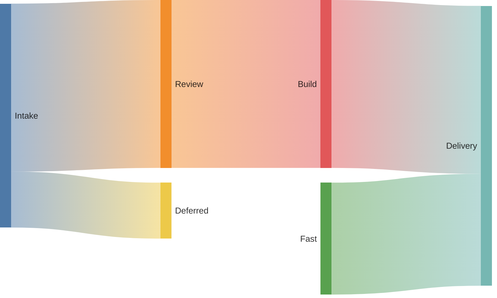

Alignment accepts `left`, `right`, `center` and `justify`. Mermaid `center` maps to `ChartSankeyAlignment.CenterSources`, placing a source directly before its earliest target; the existing native `Center` alignment retains its midpoint policy. `showValues: false` hides values in visible node labels while preserving numeric flow facts and full accessible labels. Prefix and suffix wrap the existing native value formatter as literal text. Native node padding, font fitting and value formatting remain ChartForgeX policies; this mapping does not reproduce browser layout pixel for pixel.

Explicit `MermaidSankeyRenderOptions.Width` and `Height` override source dimensions. An unspecified dimension uses the source value, then the native fallback of 960 by 560 pixels. The same precedence applies to Markdown fences. These two options are nullable; callers that previously read their integer defaults should resolve their own fallback or inspect the resulting chart's `Options.Size`. Existing integer assignments remain valid.

Source paint accepts `sankey.linkColor: source`, `target`, `gradient` or a supported literal color string. Endpoint gradients use `ChartSankeyFlowColorMode.Gradient` and the existing detached native gradient scene; quantitative flow measurements remain a separate policy. A literal link color maps to the existing ID-keyed flow fill, so it colors the whole ribbon independently of node colors. An explicit native flow fill also overrides a gradient. Native opacity, flow patterns, outlines, layout and node-label fitting retain their existing policies.

`sankey.nodeColors` is an object keyed by exact, case-sensitive CSV node IDs. It is not a color array. Quoted YAML and JSON keys preserve dots, brackets, spaces and Unicode; nested mappings and non-color values produce a located configuration error. Front matter is applied before directives, with the last value for each exact node key winning. Keys that do not name a node do not paint another node. For example:

```mermaid
---
config:
  sankey:
    linkColor: gradient
    labelStyle: outlined
    nodeColors:
      'Intake.eu[1]': '#2864B4'
      Review: '#BB6428'
      'Ready 東京': '#279473'
---
sankey-beta
Intake.eu[1],Review,6
Intake.eu[1],Review,2
Review,Ready 東京,8
```

Explicit `labelStyle: legacy` selects plain native text; `outlined` selects a four-unit surface-colored outline through the shared text owner. Neither adds a rectangular caption backdrop. An absent source label style preserves ChartForgeX's existing `ChartSankeyLabelStyle.Backdrop` default. Label columns, shortening and placement remain native policies, so these paint choices do not promise the upstream label positions or equal pixels. After conversion, callers can configure the native chart through `ConfigureSankey`, point colors and `WithFlowStyle`.

Browser sizing options such as `useMaxWidth` remain retained warnings. The pinned reference fixtures also record Mermaid 10's omission of `nodeWidth` and `nodePadding` while checking the same authored nodes and flows across versions 10, 11 and 12.

## Radar Diagrams

Radar diagrams are parsed into `MermaidRadarDocument` and converted to native ChartForgeX radar charts.

Supported radar parsing includes:

- `radar-beta` headers.
- `title` statements.
- `axis` statements with ids and optional labels.
- `curve` statements with ordered values or `axisId: value` entries.
- `showLegend`, `min`, `max`, `ticks`, and `graticule` statements.
- Source spans for retained statements, axes, and curves.

```csharp
using ChartForgeX.Mermaid;

const string source = """
radar-beta
title Capability Radar
axis ux["User Experience"], api["API"], ops["Operations"]
curve current["Current"]{70, 65, 82}
curve target["Target"]{ux: 90, api: 88, ops: 92}
showLegend true
min 0
max 100
ticks 5
graticule polygon
""";

var result = new MermaidParser().ParseRadar(source);
var document = result.Document;

var artifact = document!.ToVisualArtifact(new MermaidRadarRenderOptions {
    Id = "capability-radar",
    Width = 900,
    Height = 620
});

var svg = document.ToSvg();
var png = document.ToPng();
```

The conversion target for radar diagrams is `Chart`. Axis labels, curve values, legend visibility, explicit min/max scale, tick count, graticule text, and source spans are retained in the AST or artifact metadata. `graticule circle` and `graticule polygon` select shared native guide geometry in both SVG and PNG; the Mermaid default is circular. Automatic bounds use the observed maximum rather than rounding the data domain to nice ticks.

Nonnegative decimal `ticks` selects equal radial intervals, with five by default. `ticks 0` hides concentric guides while retaining spokes, labels and data points. Fractional values retain the authored spacing divisor: `ticks 2.5` draws three guides at 0.4, 0.8 and 1.2 times the value-axis radius; `ticks 0.5` draws one guide at twice that radius. The shared scene fits the outer guide inside the viewport while preserving the value domain and observations. Counts above 32 render 32 guides with a source warning and retain the authored count in the AST. Tick numerals require digits on both sides of a decimal point; negative, signed, exponent and shorthand decimal spellings produce located errors.

Native C# radar charts keep their polygon default and can select circular guides with `WithPolarGridShape(ChartPolarGridShape.Circle)`. Set `Options.PolarGridRingCount` from 0 through 100 for integer or fractional intervals, or leave it null to use the radial axis's generated ticks. Integer counts preserve data-point coordinates; fractional intervals fit the extended outer guide without changing source values or series forms. `PolarGridRingCount` and `MermaidRadarDocument.Ticks` use `double?`; code that reads them into `int?` must use `double?` to retain fractional values.

Static SVG and PNG share the same radar path geometry. Circular graticules, including the default, select closed cubic curves with tension `0.17`; polygonal graticules select straight edges.

Set `config.radar.curveTension` to a finite number from zero through one in frontmatter or an init directive. Zero draws straight edges; larger values increase the tangent length between observations. Polygonal source graticules keep straight edges regardless of this source setting and report a located warning that the setting is retained without being applied. Invalid values produce a located configuration error. Direct native radar series keep straight edges by default.

```yaml
---
config:
  radar:
    curveTension: 0.25
---
radar-beta
axis a["Coverage"], b["Policy"], c["Response"]
curve current["Current"]{90, 45, 80}
```

An explicit `MermaidRadarRenderOptions.CurveTension` overrides the source policy, including a polygonal graticule. After conversion, `chart.Series[index].ConfigureRadar(radar => radar.CurveTension = 0.25)` configures individual native series. Curves pass through the observations and close with cyclic tangents. Native radar series also retain this setting when composed with radial columns, using each series selected radius axis and one shared fit for the marks and annular hole. When a high tension extends beyond the ordinary radial frame, layout fits the complete curve while retaining the shared scale and original observation values. Source diagrams that previously rendered straight edges can set tension to zero to retain that appearance.

Radar configuration also maps `width`, `height`, `marginLeft`, `marginTop`, `marginRight`, `marginBottom`, `axisScaleFactor` and `axisLabelFactor` into the native chart. Dimensions are positive whole pixels within the native integer range. Margins and axis factors are finite nonnegative numbers; zero is valid. Invalid values produce located configuration errors. Init directives override frontmatter using the shared source-configuration rules.

`axisScaleFactor` changes spoke length relative to the value-axis radius; `axisLabelFactor` changes category-label anchors. They default to one and 1.05 respectively for Mermaid sources. The native theme supplies the caption gap. Long visible spokes, label anchors, fractional guides and curved outlines share the available plot space without changing observation values or the selected value domains. Direct native radar and polar charts expose `Options.PolarAxisScaleFactor` and `Options.PolarAxisLabelFactor`, both with a default of one. These options apply to the dedicated radar/polar projection; radial-column compositions retain their shared numeric radial layout.

`MermaidRadarRenderOptions.Width` and `Height` are nullable host overrides: null uses the authored source dimension, then the native preview default of 760 by 620 pixels. Callers reading either property into an `int` can use `Width ?? 760` or `Height ?? 620`, or read the converted chart's resolved size. `AxisScaleFactor`, `AxisLabelFactor` and `Padding` provide explicit host overrides; padding replaces all four source margins, including zero values. Unspecified source margins retain the native 24-pixel frame defaults. Markdown fences preserve the captured host options, and explicit fence dimensions override source dimensions. Source labels now use the 1.05 anchor factor by default; callers retaining the earlier native anchor placement can set the host `AxisLabelFactor` to one. Native heading, legend and measured-label spacing still determines the final plot, so source margins do not promise browser-renderer pixel identity.

Radar source paint uses `config.themeVariables`. `titleColor` sets the title color, and `cScale0` through `cScale11` set series colors in source order. These are explicit native style values over the active paired theme; changing light/dark mode preserves authored paint. The series palette repeats after twelve slots, and omitted slots use the native theme palette.

The following nested `themeVariables.radar` settings apply through the same chart and series owners in direct and Markdown-fence rendering:

| Source setting | Native owner | Accepted value |
| --- | --- | --- |
| `axisColor` | Spoke stroke and axis-label color | Supported native color string |
| `axisStrokeWidth` | `Options.PolarAxisStroke` | Finite width from 0 through 1024; zero hides spoke ink |
| `axisLabelFontSize` | Tick-label style | Finite logical-pixel size from 1 through 256 |
| `graticuleColor` | Guide stroke and authored guide fill | Supported native color string |
| `graticuleStrokeWidth` | `Options.PolarGridStroke` | Finite width from 0 through 1024; zero hides guide outlines |
| `graticuleOpacity` | `Options.PolarGridFillOpacity` | Finite opacity from 0 through 1 |
| `curveOpacity` | Per-series radar fill opacity | Finite opacity from 0 through 1 |
| `curveStrokeWidth` | Per-series radar `OutlineStroke` | Finite width from 0 through 1024; zero hides the outline |
| `legendFontSize` | Legend text style | Finite logical-pixel size from 1 through 256 |

Invalid supported values produce located configuration errors. Frontmatter/directive precedence follows the shared configuration rules. Native callers can configure each retained radar series through `ConfigureRadar`, including `OutlineStroke` with the existing immutable `ChartStrokeStyle`; guide strokes use that same type. SVG and PNG share the resolved plot, guide and legend paint, including color alpha. Authored nested guide fills composite in drawing order. Unmapped theme variables retain diagnostics rather than selecting another renderer.

## Treemap Diagrams

Treemap diagrams are parsed into `MermaidTreemapDocument` and converted to native ChartForgeX treemap charts.

Supported treemap parsing includes:

- `treemap-beta` headers.
- Quoted section/parent nodes.
- Sections with child nodes; an empty section without a size is rejected with its source span.
- Quoted leaf nodes with finite non-negative numeric values.
- Indentation-based hierarchy using spaces or tabs.
- Optional `:::class` suffixes on section and leaf nodes, and source-ordered `classDef` declarations. Native fill, border and caption colors apply to both groups and leaves.
- Source spans for retained statements and nodes.

```csharp
using ChartForgeX.Mermaid;

const string source = """
treemap-beta
"Infrastructure"
    "Identity": 42
    "Messaging": 18 :::risk
    "Endpoints"
        "Windows": 24
        "macOS": 9
""";

var result = new MermaidParser().ParseTreemap(source);
var document = result.Document;

var artifact = document!.ToVisualArtifact(new MermaidTreemapRenderOptions {
    Id = "infra-map",
    Title = "Infrastructure Map",
    Width = 960,
    Height = 560
});

var svg = document.ToSvg();
var png = document.ToPng();
```

Comma-separated treemap values retain the magnitude used by the pinned Mermaid parsers: `1,234.5` represents `1234.5`. Commas are separators rather than decimal marks, independently of the host culture. Nonstandard groupings such as `1,23.5` and repeated separators follow that same reference behavior. Zero-valued nodes remain available in the hierarchy and descriptive metadata.

The conversion target for treemap diagrams is `Chart`. Section nodes retain nested parent rectangles and measured headers, and their areas aggregate leaf sizes. Native group and leaf captions display the authored labels and formatted magnitudes when space permits. Distinct source-order IDs keep repeated labels independent; display labels remain unchanged. The typed AST retains class suffixes and named definitions. Portable artifact metadata retains those declarations, the authored value-format token and node, leaf, root and class counts, including zero-valued nodes that have no painted area.

Treemap selects the single class named by each `:::class` suffix. Unlike the Flowchart family, `classDef default` is an ordinary named class and applies only to an explicit `:::default` selector. Later definitions of the same class replace only the properties they declare. Definitions may follow the nodes they style and do not change indentation or parent relationships. `fill`, `stroke` and `color` map to native node fills, borders and caption colors. Hexadecimal and named colors, and native `rgb`/`rgba` forms, use the shared color parser. Unsupported CSS, including CSS variables, per-class stroke widths and opacity, remains a located warning; strict warning policy rejects it. No source CSS or callback executes. Automatic native hierarchy ink uses the painted frame and, for nested Treemap cells, its painted ancestor fills when colors are translucent. An explicit caption color remains authoritative. Transparent standalone output uses the configured native background as its fallback; an unknown external host backdrop is not inferred.

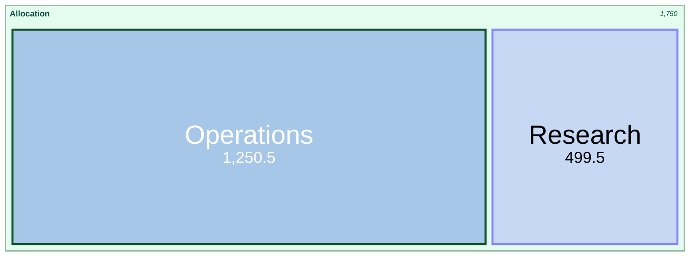

Native callers apply the same ordinal owners with `series.WithPointColor(index, fill)`, `series.WithPointStrokeColor(index, border)` and `series.ConfigurePointDataLabelStyle(index, style => style.Color = ink)`. `PointStrokeColors` is a read-only view for Treemap and Sunburst hierarchy items. `UseSeriesStrokeColor(index)` restores the family border. Explicit borders use the existing series `StrokeWidth`, bounded by the current tile or radial-band thickness; ordinary state and theme borders retain their previous behavior. Replacing the complete hierarchy clears ordinal presentation, and previously prepared output retains its captured scene.

Set `config.treemap.valueFormat` to map a source display pattern into the native immutable `ChartValueFormat`. Supported patterns include `,`, `$`, `$0,0`, `.1f`, `,.2f`, `$.2f`, `$,.2f` and `.1%`; decimal precision runs from zero through fifteen. Grouping and currency use invariant separators, percentage formatting changes the displayed caption only, and all hierarchy magnitudes remain unchanged. These patterns map to native number formatting: currency plus grouping retains the requested fixed decimals. This is not an implementation of arbitrary D3 formatting; SI, general/sign/alignment and other patterns remain located warnings. `MermaidTreemapRenderOptions.ValueFormat` accepts an explicit native host policy and takes precedence over source formatting.

Set `config.treemap.showValues: false` in frontmatter, or the equivalent legacy directive, to keep group and leaf labels while hiding their displayed magnitudes. Values, parent relationships, descriptive text and semantic metadata remain available. `MermaidTreemapRenderOptions.ShowValues` is a nullable host override: `null` uses the source setting or the native default, and an explicit `true` or `false` wins over source configuration. Markdown parsers capture that override when constructed. Native callers use `chart.ConfigureTreemap(options => options.ShowValues = false)`; ordinary data-label visibility still controls whether captions are drawn at all.

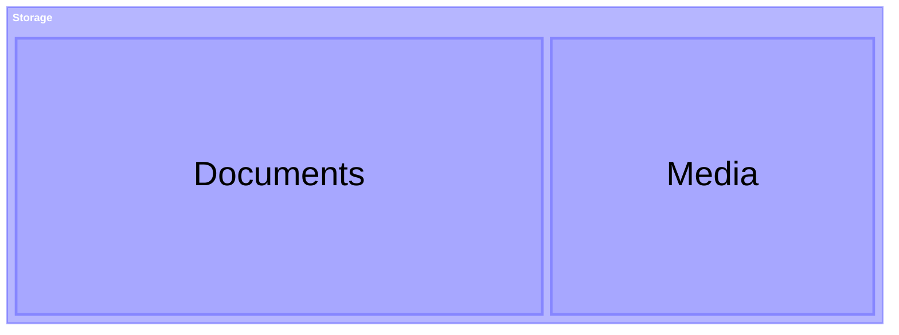

## Git Graph Diagrams

Git graph diagrams are parsed into `MermaidGitGraphDocument` and converted to the reusable `GitGraphBlock` visual block.

Supported git graph parsing includes:

- `gitGraph` headers, including orientation tokens such as `LR:`.
- `commit` statements with `id`, `tag`, `type` and display-message `msg` attributes.
- `branch` statements with optional `order` attributes.
- `checkout` and `switch` branch switching.
- `merge` statements with optional `id`, `tag` and `type` attributes.
- `cherry-pick` statements with source `id`, optional `tag`, and a validated immediate `parent`.
- Source spans, semicolon-separated commands and located errors for invalid commands.

```csharp
using ChartForgeX.Mermaid;

const string source = """
gitGraph LR:
  commit id: "base" tag: "v1"
  branch develop order: 1
  checkout develop
  commit id: "work" type: HIGHLIGHT
  checkout main
  merge develop id: "merge" tag: "v2"
""";

var result = new MermaidParser().ParseGitGraph(source);
var document = result.Document;

var artifact = document!.ToVisualArtifact(new MermaidGitGraphRenderOptions {
    Id = "release-history",
    Title = "Release History",
    Width = 980,
    Height = 460
});
```

Each command accepts only its listed attributes. String attributes (`id`, `tag`, `msg` and `parent`) require complete quoted values. Commit types are unquoted `NORMAL`, `REVERSE` or `HIGHLIGHT`; branch `order` is an unquoted non-negative integer. Unknown arguments, extra tokens, malformed quotes, invalid types and invalid order values report `CFXM008` instead of becoming default commits.

Merges require two existing branches with commits and different head commits. A branch cannot merge into itself. Cherry-picks require an existing source commit from another branch and a current branch with a commit. A supplied `parent` must be an immediate parent of that source; cherry-picking a merge requires it. The selected parent remains available as `MermaidGitGraphCommit.SourceParentCommitId` and artifact metadata. These validation errors prevent `MermaidRenderer` and the Markdown bridge from producing an artifact.

The conversion target for git graph diagrams is `GitGraphBlock`. `LR`, `TB` and `BT` choose actual horizontal, downward and upward ancestry progression in the same SVG/native-PNG layout. Source order, commit/branch IDs, parent edges, tags and selected cherry-pick parents remain unchanged. An absent direction uses `LR`; unsupported direction tokens report a located error.

The source configuration keys `gitGraph.mainBranchName`, `mainBranchOrder`, `showBranches`, `showCommitLabel`, `rotateCommitLabel` and `parallelCommits` are applied. Main-branch configuration takes effect before commands are parsed, so `checkout` uses the configured name. Branch statements retain their source order and authored optional `order` in the AST; conversion maps the reference's stable display ordering into native integer lane ranks. Unordered branches retain the pinned reference's fractional declaration ranking before positive integer orders.

`showBranches: false` hides both lanes and their captions. Commit captions can be hidden or tilted 45 degrees independently from tags. `parallelCommits: true` places independent lanes at the same furthest-parent ancestry depth; it neither reorders statements nor invents parents. Separate commits on a native branch remain distinct. The direct native parallel API requires parents to precede children; the Mermaid parser already enforces that graph-intake order. Explicit host overrides take precedence over source settings, including `false`. Null fields inherit source settings, then native defaults: visible branches/captions, ordinary sequential placement and upright captions. An absent rotation setting retains ChartForgeX's upright default, rather than adopting an upstream theme's default tilt.

```csharp
using ChartForgeX;
using ChartForgeX.VisualBlocks;

var graph = GitGraphBlock.Create().WithSize(760, 460)
    .WithDirection(GitGraphDirection.BottomToTop).WithParallelCommits()
    .AddBranch("trunk", 1).AddBranch("feature", 0)
    .AddCommit("base", "trunk", tag: "v1")
    .AddCommit("work", "feature", new[] { "base" })
    .AddCommit("next", "trunk", new[] { "base" })
    .AddCommit("joined", "trunk", new[] { "next", "work" }, GitGraphCommitType.Merge);
graph.SaveSvg("history.svg");
graph.SavePng("history.png");
graph.SaveHtml("history.html");
```

The compiled `GitGraphDepthRecipe` and its complete `.csharp.txt` programs use this ordinary Core-only block boundary. Exact gallery typography is an explicit optional program using the gallery's shipped Carlito regular/bold faces. Default programs use normal native font resolution. The native design is a deterministic static graph, not an upstream pixel-identity promise. Dense captions use the existing measured fitting/collision owner; the complete source model remains available when a caption cannot be displayed.

## Block Diagrams

Block diagrams are parsed into `MermaidBlockDocument` and converted to the reusable `BlockLayoutBlock` visual block.

Supported block parsing includes:

- `block-beta`, fixed `columns 1` through `columns 24`, and explicit `columns auto` for one source-ordered row.
- Named `block:ID[:span]` and anonymous `block` composites closed by `end`, with independent local columns, nested source membership, spaces and spans.
- Rectangles, rounded rectangles, circles, double circles, cylinders, diamonds, hexagons, stadiums, subroutines, both parallelograms and trapezoids, asymmetric blocks and filled directional arrows. Arrow directions are `left`, `right`, `up`, `down`, `x` and `y`.
- Directed and undirected connector chains with pipe or quoted inline labels, thick/dashed paint and hidden source links, including references declared before their nodes and connectors across composite boundaries.
- Ordered default, named-class and direct styles. Resolved `fill`, `stroke`, `color`, `stroke-width`, `stroke-dasharray`, `font-size`, `font-weight` and `font-style` map to captured native paint and measured captions. Unsupported declarations and unresolved CSS variables remain source facts with `CFXM007`.


```csharp
using ChartForgeX.Mermaid;

const string source = """
block-beta
columns 3
frontend["Frontend"] api["API"] database[("Database")]
frontend --> api
api --> database
""";

var result = new MermaidParser().ParseBlock(source);
var document = result.Document;

var artifact = document!.ToVisualArtifact(new MermaidBlockRenderOptions {
    Id = "service-path",
    Title = "Service Path",
    Width = 900,
    Height = 420
});
```

The conversion target is `BlockLayoutBlock`. Its flat `Items` collection retains source order and optional `ParentId`; composite items declare local `Columns` or `AutoColumns`. `AddComposite`, parent-aware `AddItem` and `AddSpace` build the same native hierarchy directly. IDs are global, parents must identify composites, and cycles, depth overflow and spans wider than their containing grid are rejected before paint. A composite is a real source cell with retained children, not a replacement aggregate.

Nested cells, captions and connectors use the same native SVG mark owner that supplies PNG. Existing flat diagrams with omitted hierarchy/style options retain their previous layout. Explicit `columns auto` now means a single source-ordered row; omit the statement to use the caller's `MermaidBlockRenderOptions.Columns` default. `BlockLayoutItem.Clone()` detaches mutable typography and metadata; immutable outline values can be shared safely. Direct native caption overrides use measured font/color/case/language/variation/palette settings; decorated or scripted baselines are rejected rather than silently rendered as plain text.

The native grid deliberately has deterministic fixed-frame geometry rather than Mermaid's browser-measured pixel layout. Very dense frames can reduce measured caption size or be rejected when no cell surface fits. HTML labels, rich Markdown, arbitrary CSS and orthogonal obstacle-avoiding connector routing are not implied by these shape and hierarchy mappings. Native SVG and PNG have the same fixed frame; a browser may scale that completed SVG without running another layout.

`BlockLayoutDepthRecipe` is compiled by the example project and its standalone snippet path. `ExampleRecipeSource.EmitBlockLayout()` emits the complete core-package program with SVG, PNG and HTML outputs, without coercing a static block into the prepared chart recipe registry.

## Packet Diagrams

Packet diagrams are parsed into `MermaidPacketDocument` and converted to the reusable `PacketLayoutBlock` visual block.

Supported packet parsing includes:

- `packet-beta` headers.
- Optional `title` statements.
- Explicit bit ranges such as `0-15: "Source Port"`.
- Single-bit fields such as `16: "Reserved"`.
- Relative bit-count fields such as `+32: "Payload"`.
- Contiguous-field validation from bit zero, matching Mermaid packet semantics.
- Source spans and retained statements for diagnostics.

```csharp
using ChartForgeX.Mermaid;

const string source = """
packet-beta
title TCP Header
0-15: "Source Port"
+16: "Destination Port"
32-63: "Sequence Number"
+32: "Acknowledgment Number"
""";

var result = new MermaidParser().ParsePacket(source);
var document = result.Document;

var artifact = document!.ToVisualArtifact(new MermaidPacketRenderOptions {
    Id = "tcp-header",
    Width = 900,
    Height = 420,
    BitsPerRow = 32
});

var svg = document.ToSvg();
var png = document.ToPng();
```

The conversion target for packet diagrams is `PacketLayoutBlock`. Packet fields become contiguous labeled bit rectangles with start/end bit metadata in SVG output. The same reusable block can be used directly from ChartForgeX without Mermaid.

Packet source configuration accepts `bitsPerRow` (an integer from 1 to 512), `showBits` (a Boolean) and `bitOrder` (`ascending` or `descending`) in frontmatter and initialization directives. The last declaration of each setting takes effect. Explicit host options override each source value independently; omitted values use the source setting, then the defaults of 32 bits per row, visible bit numbers and ascending order.

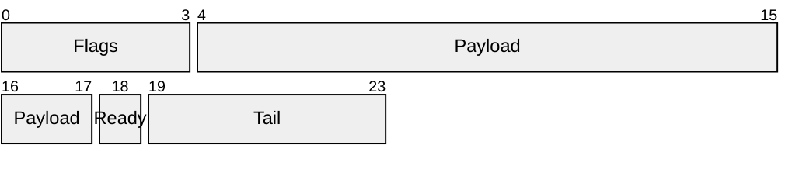

Descending order mirrors each row, including a partial final row, while fields retain their ascending source ranges. Fields that cross row boundaries keep their labels and split ranges. SVG and PNG use the same native layout. To override source order, set `MermaidPacketRenderOptions.BitOrder = PacketBitOrder.Ascending`; the native block exposes `WithBitOrder` and `BitOrder` directly.

`MermaidPacketRenderOptions.BitsPerRow` and `ShowBitNumbers` are nullable so hosts can distinguish an omitted override from an explicit value. Callers that read these properties can use `?? 32` and `?? true` for the renderer defaults.

Packet dimensions and spacing also accept independent source and host values:

| Source setting | Native block and host option | Accepted value |
| --- | --- | --- |
| `bitWidth` | `BitWidth` / `WithBitWidth` | Finite logical pixel width of at least 1 |
| `rowHeight` | `RowHeight` / `WithRowHeight` | Finite logical pixel height of at least 1 |
| `paddingX` | `FieldGap` / `WithFieldGap` | Finite horizontal gap of at least 0 |
| `paddingY` | `RowGap` / `WithRowGap` | Finite vertical gap of at least 0 |

For example, add `bitWidth: 24`, `rowHeight: 40`, `paddingX: 3` and `paddingY: 7` beneath `packet` in the source configuration above. Host properties use the same last-source-value precedence as row width and direction; an explicit zero gap overrides source spacing. Markdown parsers snapshot these host options when constructed.

These values are preferred dimensions within the fixed host preview. The shared renderer reduces bit widths, field heights and row gaps when necessary to fit that viewport, and reserves measured space above each row for visible bit numbers. A requested row gap remains unchanged when the preferred rows and bit labels fit; an oversized gap uses the space left after those rows and labels. Oversized horizontal gaps leave a positive field within its bit cell. They do not expand the canvas. When no dimension or gap is supplied, native automatic sizing remains in effect. This fitting policy gives SVG and PNG the same geometry; it does not promise Mermaid.js pixel dimensions.

## Venn Diagrams

Venn diagrams are parsed into `MermaidVennDocument` and converted to the reusable `VennDiagramBlock` visual block.

Supported Venn parsing includes:

- `venn-beta` headers.
- `title` statements.
- `set id [label] : size` declarations.
- `union id,id [label] : size` intersections for two or three sets.
- `text id,id textId [label]` statements.
- `style` statements for renderable `fill`, `stroke`, and `color` values.
- Source spans and retained statements for diagnostics.

```csharp
using ChartForgeX.Mermaid;

const string source = """
venn-beta
title Capability overlap
set API ["API"] : 60
set UI ["UI"] : 55
set Ops ["Operations"] : 45
union API,UI ["Shared UX"] : 18
union API,UI,Ops ["Platform"] : 5
""";

var result = new MermaidParser().ParseVenn(source);
var document = result.Document;

var artifact = document!.ToVisualArtifact(new MermaidVennRenderOptions {
    Id = "capability-overlap",
    Width = 780,
    Height = 460
});

var svg = document.ToSvg();
var png = document.ToPng();
```

The conversion target is `VennDiagramBlock`, limited to one, two or three sets. Circle areas preserve the set-size ratios. Two-set overlaps match the requested area within numeric precision; painted intersections use actual circular arcs and retain their authored fill, outline, text color and opacity. Invalid memberships, including intersections larger than a participating set or algebraically impossible exclusive regions, produce located errors.

Arbitrary three-set cardinalities do not always admit an exact circular layout. `ToVennDiagramBlock().MeasureLayout()` exposes `Circles`, `Regions` with `RequestedArea` and `ActualArea`, `MaximumRelativeAreaError` and `IsAreaAccurate`. The parser reports `CFXM009` when a three-circle residual exceeds 0.5% of the largest source set; hosts can reject it through the shared warning policy. This is a bounded circular fit, not a promise of arbitrary Euler geometry. Captions use the same measured placement in SVG and PNG; labels that cannot fit remain in the model even when omitted from the visible lanes.

## Agent Workflows

`agentflow-beta` produces a `MermaidAgentflowDocument`. Nodes, nested flows, global declarations, connectors and sequence/reference/failure edges remain typed source facts. Native conversion uses `TopologyChart`: expanded flows become compound groups, collapsed flows become one visible node, and external relationships resolve to the visible container. Relationships entirely inside a collapsed container are retained in the document rather than painted as artificial self-loops.

```mermaid
agentflow-beta LR
global
  policy["Review policy"]@{ shape: refdoc }
end
flow review["Request review"]
  input["Request"]@{ shape: input }
  check["Check policy"]@{
    shape: tool
    instruction: "Show the policy to the reviewer."
    labels: [manual, bounded]
  }
  approve["Approved?"]@{ shape: decision }
  input --> check
  check --> approve
  check -.- policy
end
```

Use `new MermaidParser().ParseAgentflow(source)` for the typed document, then `document.ToTopologyChart()` or `document.ToVisualArtifact()`. The generic `MermaidRenderer.Render` and Markdown fences use the same parser and native converter. Metadata mappings, arrays and scalars are bounded immutable values inside the typed metadata tree; reserved prototype-shaped mapping keys are removed recursively. This is a diagram-data subset, not a YAML execution environment. Instructions, expressions, connector references and URLs never run or fetch content. Unsupported presentation, shape and animation settings retain located diagnostics.

Agentflow owns its shape catalog independently from Flowchart. The documented `task`, `tool`, `input`, `decision`, `refdoc` and `action` aliases retain their native surfaces. `rect` and `round` select the family's rounded task surface; `rect` previously produced a square rectangle. Canonical subprocess, input, decision, reference-document and action names use the same six native surfaces. Connector declarations retain a rounded surface. Collapsed flows retain native containment and crossing relationships; their summary marker presentation requires separate qualification.

Flowchart-only shape names are no longer inherited by Agentflow. Names removed by the family, such as `circle`, `stadium`, `cylinder`, `lean-left` and `odd`, produce a located `CFXM008` error and no direct or fenced artifact. Authored shape names must be lowercase without underscores; internal names such as `roundedRect` remain programmatic values. Other unsupported names remain inert metadata with `CFXM007`, using the default task surface under permissive rendering. The existing reject-warnings policy also rejects that fallback. Parsed metadata preserves the original name in both cases. A programmatically assigned unsupported `MermaidAgentflowNode.Shape` still fails conversion clearly. Use Flowchart when the larger Flowchart shape catalog is required.

## ZenUML Occurrences

`zenuml` has its own parser and typed `MermaidZenUmlDocument`. It is not translated into Mermaid `sequenceDiagram` text. Calls with bodies retain caller context and activations; creation retains the created participant's position; assignments, returns, asynchronous messages, comments and control fragments lower directly to `SequenceArtifact` facts.

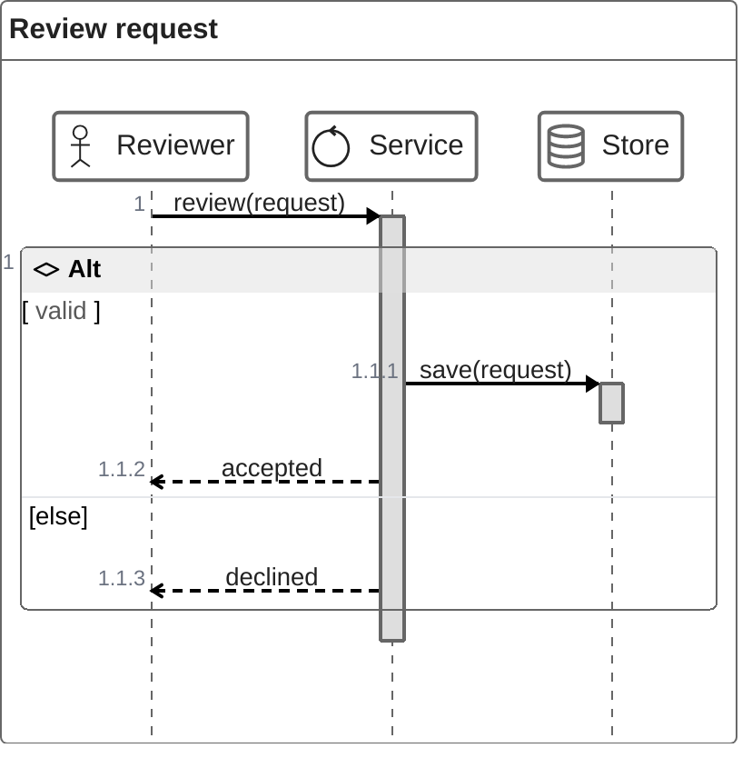

`new MermaidParser().ParseZenUml(source)` exposes the separate occurrence tree. Use `document.ToSequenceArtifact()` to configure a native sequence, or the shared artifact/direct/fence exports to retain captured source policy. Participant groups must be contiguous and non-overlapping. A call without an authored caller uses an explicit external context instead of inventing a method-named participant. Conditions and arguments are inert strings, not executable expressions.

The supported control fragments include conditional branches, loops, optional, parallel, critical and try/catch/finally blocks. Exception handling uses native `SequenceArtifactBlockKind.Try`, preserving catch/finally order. Upstream ZenUML can label that fragment `break`; CFX keeps the native exception-handling name. Reference and divider blocks use the native sequence presentation roles. Participant stereotypes, literal Unicode or finite symbol shortcodes, hexadecimal fills and positive minimum widths map to native participant fields. Unknown shortcodes and unsupported presentation retain located diagnostics.

The official Mermaid ZenUML plugin manages actual grammar parsing during rendering; its Mermaid-facing parser is a no-op. The external-plugin fixture corpus therefore separates real reference rendering and visible-semantic observation from ordinary pinned parser acceptance. Neither a recognized header nor a successful no-op parse qualifies the occurrence mapping. The pinned plugin rejects the presentation fixture containing a literal lock glyph in a participant declaration. Its shortcode-based ordering fixture renders reference frames and a divider, while also painting an extra participant box. These retained observations do not establish matching participant widths, complete grammar support or native/reference pixel equality.

## Railroad Grammars

All four Railroad headers produce a `MermaidRailroadDocument`: `railroad-beta` for explicit IR constructors, `railroad-ebnf-beta` for EBNF, `railroad-abnf-beta` for ABNF, and `railroad-peg-beta` for PEG. They lower to the same immutable `RailroadExpression`/`RailroadRule` model and native `RailroadDiagramBlock` scene. Rule IDs, declaration order, literal/reference distinctions and original source spans remain inspectable.

| Frontend | Supported expression contracts | Explicit limits |
| --- | --- | --- |
| IR | `terminal`, `nonterminal`, `special`, `sequence`, `choice`, `optional`, `zeroOrMore`, `oneOrMore` | Only these constructors are accepted; constructor arguments are diagram data. |
| EBNF | `=`/`::=`, quoted literals, references, sequences, `\|` choices, groups, `[]`, `{}`, postfix `?`/`*`/`+`, `-` exceptions and `? special sequence ?` | This is the documented native subset, not every EBNF dialect. |
| ABNF | Case-insensitive rule IDs, double-quoted literals with optional RFC 7405 `%i`/`%s` case prefixes, `/` alternatives, optional/groups, ordered non-negative repetition bounds, `%x`/`%d`/`%b` scalar/range/sequence forms | Rules require a terminating semicolon; its trailing text is a comment. Case-prefixed literals require adjacent double quotes and printable ASCII. Single-quoted strings are rejected. This is Mermaid's bounded frontend, not full RFC ABNF. |
| PEG | `<-` rules, ordered `/` choice, sequences/groups, one postfix `?`/`*`/`+`, `&`/`!` predicates, `.`, symbolic character classes/ranges and escaped Unicode scalars | Unsupported operators produce located errors. Character classes remain symbolic without code-point expansion; predicates are depicted, never executed. |

All rules end with `;`. Duplicate identities, reversed repeat bounds, invalid numeric ranges, malformed strings and unsupported constructors report located errors and prevent direct/fenced rendering. ABNF rule comparison ignores case; the other frontends preserve case-sensitive identity. Unprefixed and `%i` ABNF literals ignore case; `%s` literals retain case-sensitive semantics, as do EBNF/PEG/IR literals. Rule references and repetition counts stay symbolic, including recursion; rendering neither expands them nor creates an executable recognizer.

```csharp
using ChartForgeX.Mermaid;

const string source = """
railroad-ebnf-beta
list = item { "," item } ;
item = "value" | "other" ;
""";

var parsed = new MermaidParser().ParseRailroad(source);
if (!parsed.HasErrors && parsed.Document != null) {
    var artifact = parsed.Document.ToVisualArtifact(new MermaidRailroadRenderOptions {
        Id = "list-grammar",
        Width = 720,
        Height = 320
    });
    artifact.SaveSvg("grammar.svg");
    artifact.SavePng("grammar.png");
}
```

`Width` and `Height` are minimum natural dimensions. Native grammar measurement reserves the complete rule geometry before export; an explicitly undersized native frame is rejected rather than clipped. The shared Mermaid source/model/depth/output/pixel limits and cooperative cancellation still apply. A plain `RailroadDiagramBlock` additionally bounds native layout to 512 rules, 32,768 expression occurrences and 128 nesting levels. SVG and PNG use the same scene and font owner; there is no separate PNG layout or browser runtime.

Journey and Timeline portable artifact JSON retains typed native sections, tasks or periods, actor membership, ordinal scores, ordered events and native presentation. Read with `VisualArtifactInterchangeEnvelope.FromJson(json).ToJourneyDiagramBlock()` or `.ToTimelineDiagramBlock()`, edit the imported block or replace immutable entries in the envelope, then export native SVG/PNG again. These families require version 2. Source-language identity and compact keyed UTF-16 source-span facts stay on the envelope; importing does not reconstruct a Mermaid AST. Period labels remain categorical text. Empty diagrams and invalid scores, section references or event lists reject through the native validation rules.

Railroad portable JSON reconstructs the typed native rule model through `.ToRailroadDiagramBlock()`. Keep the typed source document when a consumer needs original grammar syntax rather than native semantic editing. Pinned-reference comparisons and dense grammar geometry have their own qualification limits; typed round-tripping does not establish reference pixel equality.

## Ishikawa Diagrams

Ishikawa diagrams are parsed into `MermaidIshikawaDocument` and converted to the reusable `FishboneDiagramBlock` visual block.

Supported Ishikawa parsing includes:

- `ishikawa` and `ishikawa-beta` headers.
- A root effect statement on the first body line.
- Indentation-based cause and sub-cause hierarchy.
- Source spans for the effect and each cause node.
- Retained raw statements for diagnostics.

```csharp
using ChartForgeX.Mermaid;

const string source = """
ishikawa-beta
Delayed release
  People
    Handoffs
      Timezone gaps
  Process
    Late review
  Platform
    Slow build
""";

var result = new MermaidParser().ParseIshikawa(source);
var document = result.Document;

var artifact = document!.ToVisualArtifact(new MermaidIshikawaRenderOptions {
    Id = "release-root-cause",
    Width = 900,
    Height = 520
});

var svg = document.ToSvg();
var png = document.ToPng();
```

The conversion target is `FishboneDiagramBlock`. Ordinary fixed scenes retain their existing geometry when fitted captions and the cause tree fit. Source conversion selects measured natural lanes when captions would be shortened, overlap or escape the frame, or when a nested cause needs its actual parent connector. Every cause occurrence stays in source order; equal captions remain separate occurrences. Wrapped captions use the native font owner at its normal requested size, and connector gutters stay outside caption cells. Width and height are minimum dimensions for this expanded layout, so a compact host can scroll the completed frame.

Direct native callers opt into the same measured layout with `MeasureNaturalSize()` and `WithNaturalSize(minimumWidth, minimumHeight)`. Call `WithNaturalSize` again after changing causes, padding or typography; a later undersized frame is rejected rather than silently dropping captions. The existing fixed direct-block default is unchanged. The native/source limits remain 512 total nodes including the effect and 12 cause levels.

Supported source presentation includes `ishikawa.diagramPadding` (finite and non-negative), `ishikawa.useMaxWidth`, the root `fontSize`, and the shared safe font/theme settings. A theme-variable font size takes precedence over the root size. `themeVariables.lineColor` paints the spine, branch rails and head outline; `mainBkg` paints the effect head; `textColor` paints the captions. Values use native color parsing, not CSS execution. Explicit host themes retain precedence. Omitted family settings retain the incumbent source frame when it fits; expanded natural scenes preserve their frame in HTML. Explicit `useMaxWidth: true` selects the existing fit-to-width HTML policy, while `false` preserves a scrollable frame. These host policies do not change SVG or PNG geometry.

The maintained `ishikawa-native-depth.mmd` fixture and `IshikawaDepthRecipe` carry a complete distinguishing cause tree through the source/native owners. `ExampleRecipeSource.EmitIshikawa` emits the compiled Core-only program that writes SVG, native PNG and HTML, without requiring a browser or reference engine. Portable artifact JSON retains the common envelope and source counts; it does not reconstruct a typed Fishbone tree. Keep the document or native block for semantic edits.

Ishikawa's pinned grammar accepts text and indentation, not per-node class/style declarations. HTML labels, arbitrary CSS, browser hand-drawn geometry and exact reference pixel layout are outside this native mapping. Large natural diagrams may exceed the captured output/pixel limits; those limits still reject export before raster allocation. Host scaling can reduce on-screen caption size, so use the preserved natural frame when complete native-size reading is required.

## Wardley Maps

Wardley maps are parsed into `MermaidWardleyDocument` and converted to the reusable `WardleyMapBlock` visual block.

Supported Wardley parsing includes:

- `wardley-beta` headers.
- `title` and `size` statements.
- Custom evolution stage labels.
- Anchors and components with visibility/evolution coordinates.
- Node suffixes for inertia, sourcing strategy, and label offsets.
- Dependency links, dashed links, flow labels, and semicolon labels.
- `evolve`, `note`, `annotation`, `accelerator`, `deaccelerator`, and `pipeline` statements.
- Source spans and retained raw statements for diagnostics.

```csharp
using ChartForgeX.Mermaid;

const string source = """
wardley-beta
title Platform map
evolution Genesis -> Custom Built -> Product -> Commodity
anchor User [0.95, 0.05]
component Portal [0.80, 0.35]
component API [0.70, 0.45] (build)
User -> Portal
Portal +'uses'> API
evolve API 0.75
""";

var result = new MermaidParser().ParseWardley(source);
var document = result.Document;

var artifact = document!.ToVisualArtifact(new MermaidWardleyRenderOptions {
    Id = "platform-map",
    Width = 900,
    Height = 560
});

var svg = document.ToSvg();
var png = document.ToPng();
```

The conversion target for Wardley maps is `WardleyMapBlock`. The static renderer produces a deterministic map with axes, evolution stages, nodes, dependencies, evolutions, notes, annotations, markers, and pipelines. It is not Mermaid's browser layout, and advanced styling, annotation-box rendering, pipeline styling, and browser visual parity still need hardening.

## Visual Fidelity

ChartForgeX Mermaid rendering is deterministic ChartForgeX rendering, not a pixel-perfect clone of any browser renderer.

Flowchart rendering maps Mermaid concepts into the ChartForgeX topology visual vocabulary:

| Mermaid concept | ChartForgeX mapping |
| --- | --- |
| Flow direction | Topology layout direction. |
| Subgraph | Topology group. |
| Node label | Topology node label. |
| Edge label | Topology edge label. |
| Link length | Native `TopologyEdge.MinimumRankSpan`, also used by swimlane diagrams. |
| `click` href and tooltip | Topology node href and tooltip. |
| `classDef`, `class`, `style` colors | Node style metadata and supported color fields. |
| `linkStyle stroke` | Edge color. |
| `linkStyle stroke-dasharray` | Dashed edge line style. |

When Mermaid exposes a concept that ChartForgeX cannot render exactly yet, keep it in the AST and metadata first, then add renderer mapping deliberately. That keeps the parser honest while allowing visual fidelity to improve without breaking the language model.

## Markdown Fences

Use `ChartForgeX.Markup.Mermaid` when Markdown documents should parse Mermaid fences:

```csharp
using ChartForgeX.Markup.Mermaid;

var result = new MermaidVisualMarkupParser().Parse(markdown);
foreach (var artifact in result.Artifacts) {
    // Render, inspect, export, or hand the artifact to a native host.
}
```

Hosts that already parse Markdown can pass discovered `VisualMarkupBlock` instances directly:

```csharp
var result = new MermaidVisualMarkupParser().ParseBlocks(blocks);
```

A host can supply a page fallback before Mermaid captures native appearance:

```csharp
var parser = new MermaidVisualMarkupParser(new MermaidRenderOptions(), VisualThemeMode.Dark);
var result = parser.Parse(markdown);
```

The fallback applies only to fences without an authored theme. Source palettes still win, and a host default is not recorded as an authored source theme. Existing constructors retain native defaults.

That flow keeps Mermaid syntax handling inside ChartForgeX while avoiding a second Markdown scan in native IX or OfficeIMO-backed pipelines.

Use `MermaidRenderOptions` when a host wants shared defaults for several diagram families:

```csharp
using ChartForgeX.Markup.Mermaid;
using ChartForgeX.Mermaid;

var parser = new MermaidVisualMarkupParser(new MermaidRenderOptions {
    Flowchart = new MermaidFlowchartRenderOptions { Width = 1180, Height = 720 },
    Gantt = new MermaidGanttRenderOptions { Width = 960, Height = 560 }
});

var result = parser.ParseBlocks(blocks);
```

Fence attributes such as `id`, `title`, `subtitle`, `width`, `height`, and family-specific render knobs use the same normalized option parsing as native ChartForgeX markup. Malformed numeric, boolean, or date values produce line-aware diagnostics instead of being silently ignored.

## Mermaid.js Conformance Fixtures

The repository includes a test-time Mermaid.js fixture harness under `tests/mermaid-conformance`. It runs pinned official Mermaid 10.9.8, 11.17.2 and 12.2.0 references in separate processes while keeping ChartForgeX packages dependency-free at runtime. `compatibility.json` records syntax acceptance or rejection for every source and version-specific semantic expectations where upstream behavior differs. The corpus contains 171 sources: 150 fixture sources, five sources in the historical `recognition/` folder, and 16 invalid sources. The recognition-folder examples now use the native Agentflow and Railroad paths. Shared semantic expectation files record the checked native facts. Shared facts include flowchart classes and resolved node/link paints, GitGraph relationships and cherry-pick parent selection, and Gantt scheduling and visible-end dates. Reference calendar fixtures run in UTC so local date parsing and epoch arithmetic are deterministic across hosts. A separate opt-in browser lane renders selected upstream fixtures through HtmlTinkerX and records native SVG/PNG beside them.

```powershell
Set-Location .\tests\mermaid-conformance
npm ci --ignore-scripts --no-audit --no-fund --engine-strict
npm run validate
```

`Build.ps1` runs the same three-reference validation before the solution build and .NET test suite. The default command validates `fixtures/`, `recognition/` and `invalid/`; use `node validate-mermaid.mjs fixtures --reference 10` for a focused folder/version run. New fixtures require version metadata. Documented syntax and semantic rejections are checked independently of accepted-source facts, so a failed semantic comparison cannot be counted as an expected source rejection.

The 12.2.0 reference accepts 155 sources and rejects all 16 invalid sources. These lanes qualify the checked examples rather than every syntax form in those major versions. Older sequence autonumber and requirement sources have dedicated fixtures; newer families and spellings are marked unavailable on references that reject them. Mermaid 10 also handles an excluded Gantt endpoint differently: an interval ending January 5 with January 5 excluded schedules its successor on January 5, while Mermaid 11/12 schedules it on January 6. ChartForgeX uses the current result and keeps the older expectation visible in the corpus instead of introducing a version-dependent renderer.

Run the observed reference-render lane with an absolute task output directory (`$outputDirectory` below):

```powershell
./Build/Test-MermaidReferenceRendering.ps1 -OutputRoot $outputDirectory
```

This uses the same pinned npm packages and the existing HtmlTinkerX browser cache. It loads Mermaid only inside the test browser, with explicit classic look and Dagre layout to keep appearance defaults controlled across versions. The lane checks label content, relationship counts, native caption containment and script-free native output for multiline/Markdown labels, repeated linkStyle replacement, compound routes, class notes/generics/two-way markers, state notes/control nodes/composites, ER aliases/attributes and sequence boxes/lifetimes. Captures show upstream SVG, native SVG and native PNG in compact/light and wide/dark examples; layout, palette, Markdown emphasis and exact dimensions deliberately differ. These observations qualify those fixtures, not every grammar form or pixel fidelity. Hosted execution of this optional lane remains separate from the normal quality workflow.

````markdown
```mermaid {#incident-flow title="Incident Flow" subtitle="Static preview" width=1180 height=720}
flowchart LR
  alert[Alert] --> triage{Triage}
  triage -->|known| runbook[Runbook]
  triage -->|new| owner[Service owner]
```
````

````markdown
```mermaid {#incident-sequence title="Incident Sequence" width=960 height=560}
sequenceDiagram
participant U as User
actor API as Native API
U->>API: Request
API-->>U: Response
```
````

````markdown
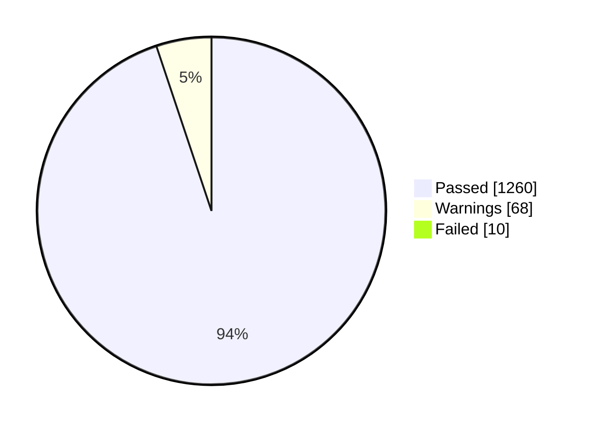
````

````markdown
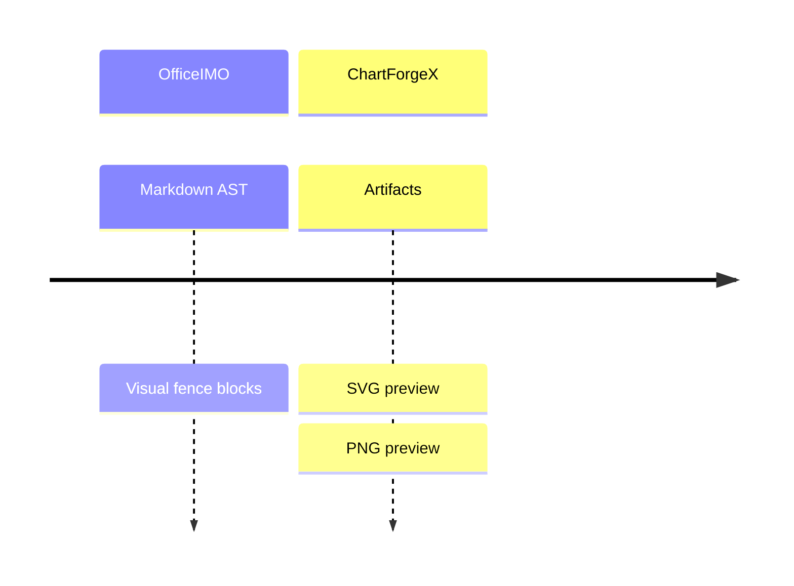
````

````markdown
```mermaid {#ticket-trend title="Ticket Trend" width=900 height=520 dataLabels=true}
xychart-beta
x-axis [Jan, Feb, Mar]
y-axis "Ticket count" 0 --> 100
bar [30, 60, 90]
line [25, 50, 80]
```
````

````markdown
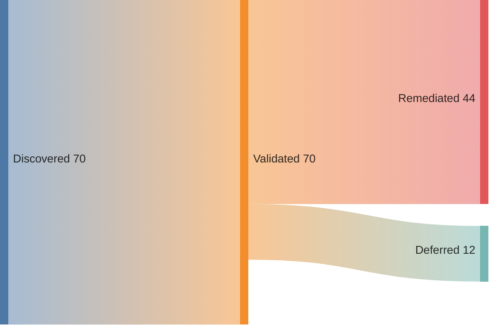
````

````markdown
```mermaid {#capability-radar title="Capability Radar" width=900 height=620}
radar-beta
axis ux["User Experience"], api["API"], ops["Operations"]
curve current["Current"]{70, 65, 82}
curve target["Target"]{ux: 90, api: 88, ops: 92}
min 0
max 100
ticks 5
```
````

````markdown
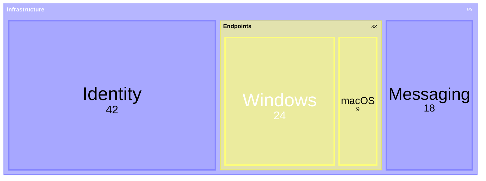
````

````markdown
```mermaid {#project-plan title="Project Plan" width=960 height=560 today=2026-01-08}
gantt
dateFormat YYYY-MM-DD
axisFormat %m/%d
section Build
Design : active, des, 2026-01-01, 5d
Implement : crit, impl, after des, 7d
Ship : milestone, ship, after impl, 0d
```
````

Fence attributes currently understood by the bridge are `id`, `title`, `subtitle`, `width`, `height`, `padding`, `series`, `dataLabels`, and `today` where the target diagram type uses them.

## Growth Path

The [Mermaid roadmap](../TODO.md#mermaid) tracks language depth, version coverage and missing families. New families follow the same pattern:

1. Detect the diagram family and preserve source spans.
2. Add typed AST nodes for the real Mermaid grammar used by that family.
3. Add diagnostics for unsupported syntax.
4. Convert to an existing ChartForgeX model when the mapping is natural, or introduce a reusable product-neutral artifact model when it is not.
5. Add focused parser tests, conversion tests, and static SVG/PNG smoke output.

For IX and other consuming hosts, the preferred integration is to accept Mermaid where users already know Mermaid, accept `chartforgex` fences where ChartForgeX adds richer native artifacts, and keep host-specific behavior outside the parser packages.

Oversized source typography fits Sankey captions and rectangular hierarchy labels within their native mark and column bounds. Ordinary legend text still follows the configured row and height budget; oversized legend text can shrink to fit. CSS font-size functions containing whitespace or line breaks are retained with a warning because native rendering does not evaluate CSS sizing expressions.

The optional peer reference lane runs `node validate-mermaid.mjs --peer --output $outputDirectory`. It uses an isolated, locked, test-only .NET 10 project and the pinned MIT Mermaider 0.15.1 package; it is outside the normal solution and shipped package graph. Its report distinguishes rendered output, unsupported semantics and engine failures. The official Mermaid references remain the language authority. Neither reference lane requires equal geometry or pixels.

### Native Venn area qualification

`VennDiagramBlock.MeasureLayout()` returns placed circles and each declared intersection's `RequestedArea`, `ActualArea`, real circular-arc `Path` and interior label anchor. `MaximumRelativeAreaError` divides the largest absolute overlap error by the largest source set size; `IsAreaAccurate` uses a 0.005 limit. One-to-three set-circle areas preserve source ratios, and two-set overlap is solved directly. Arbitrary three-set cardinalities cannot always be represented exactly by circles: the bounded deterministic fit reports its residual rather than claiming exact geometry. Algebraically impossible overlaps and duplicate memberships are errors at the authored union. Zero-area regions remain empty. Explicit fill, outline width, fill opacity and text paint are preserved.

### Swimlane crossing configuration

The pinned Swimlane source key is `swimlane.lineHops`. False disables crossing paint; absent, scalar null, true or `'arc'` selects Arc with radius six; `'gap'` selects Gap. Other values, including structured arrays/objects and quoted `'null'`, produce located configuration errors. `lineJumps` is not an alias. Frontmatter and directives retain the existing precedence and original declaration spans.

Source lowering uses the explicit native `SkipUnsupported` curve policy. Default Flowchart Basis paths remain unchanged and produce no invented straight crossings. Eligible continuous native M/L paths can use the same crossing owner; unsupported native curves neither receive hops nor become underpasses through a guessed control polyline. Composition with stepped or rounded paths requires actual resolved-path eligibility. This intentionally replaces the earlier unsupported-source warning for valid Arc/Gap settings. Native policy null remains unchanged.

The pinned renderer prefers the horizontal edge at a crossing. Native topology instead uses its actual stable paint order, preserving selection, priority and shared-line-layer behavior. This ownership difference is retained explicitly; the source settings do not establish whole-diagram or pixel equality. Orthogonal exclusions, neighboring-radius limits and bounded work admission are documented in [native topology](topology.md#orthogonal-crossing-paint).

### Finite Flowchart assets

Flowchart `icon` metadata resolves an exact qualified identity from `MermaidFlowchartRenderOptions.IconCatalog`. The default is the native finite catalog. Flowchart `img` metadata resolves an exact caller-owned `RgbaImage` from `ImageBindings`:

```csharp
var options = new MermaidRenderOptions {
    Flowchart = new MermaidFlowchartRenderOptions {
        ImageBindings = new Dictionary<string, RgbaImage> {
            ["team"] = new RgbaImage(2, 1, new byte[] { 255, 0, 0, 255, 0, 255, 0, 255 })
        }
    }
};
var result = MermaidRenderer.Render("flowchart LR\npicture@{img:'team',label:'Review group',pos:'t',constraint:'on',h:40}", options);
```

The image key is an identity. Rendering performs no file, URL, network or provider request for it. Options and Markdown parser snapshots detach caller pixels for at most 256 keys and 256 MiB of distinct required RGBA views per snapshot. Identical borrowed arrays with the same required length share one owned copy inside that snapshot. This is separate from decoder, native scene, export and encoder budgets.

A real authored caption selects its literal effective source font role, an 8-unit gap and top (`pos:t`) or bottom placement. Missing and explicitly empty labels remain distinct source facts without an invented visible ID caption. Image width, height and `constraint:on` follow the pinned handler's finite dimension/aspect rules; icon forms use the existing native glyph and contour owners. Unbound identities and unsupported group/family asset metadata remain located and inert. The source text, property tokens and value spans remain available.

Portable artwork data retains its existing 2 MiB recognized raster URI limit and 8 MiB envelope limit, alongside decode/pixel and ordinary text/metadata limits. Large or malformed resources fail through the existing bounded owner; this is not a total-memory guarantee. Flowchart `rect`, `person`, `dbl-circ`, `bucket` and `stadium` surface opacity, ordinary flowchart containers and Agentflow task opacity use the native surface owner. Labels and child nodes keep their own opacity. Double-circle leaves retain their isolated parent; stadium fill and stroke use the existing native curve with separate paint elements. This preserves paint composition without importing rough path geometry or promising identical upstream layout. Other source shapes, assets, collapsed Agentflow flows, nonclassic looks and UseCase surface opacity retain located warnings. Unresolved source theme-role defaults remain separate capabilities.
